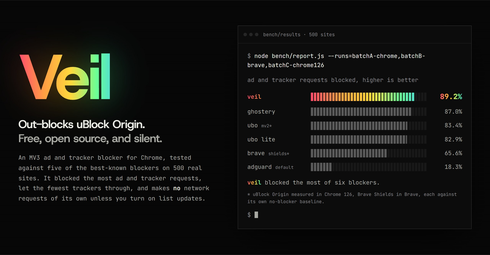
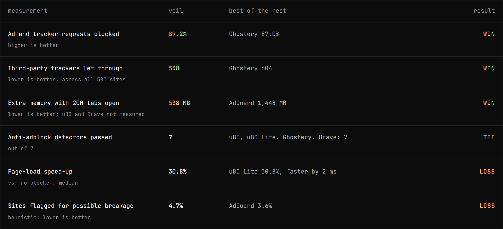
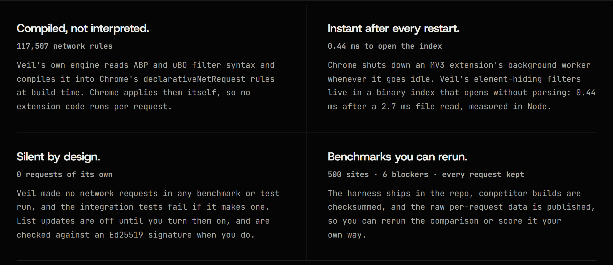
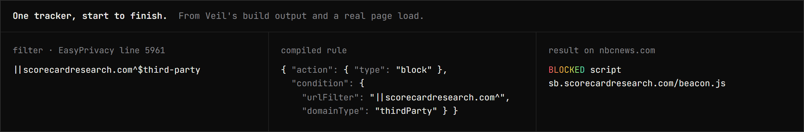

<p align="center">
  <picture>
    <source media="(prefers-color-scheme: dark)" srcset="docs/readme/logo-dark.png">
    
  </picture>
</p>

<p align="center">
  <em>Out-blocks uBlock Origin. Free, open source, and silent.</em>
</p>

<p align="center">
  
  
  
  
  
</p>

<p align="center">
  
</p>

<p align="center">
  <strong>89.2% of ad and tracker requests blocked &middot; 538 trackers let through &middot; 538 MB at 200 tabs</strong><br>
  <strong>The most blocked of six blockers on 500 real sites.</strong> It ties on one measurement and loses two, shown below.<br>
  <sub>Against uBlock Origin, uBlock Origin Lite, Ghostery, AdGuard and Brave Shields, November 2026. <a href="#numbers">Details</a>.</sub>
</p>

<p align="center">
  <sub><a href="#install">Install</a> &middot; <a href="docs/RESULTS.md">Full results</a> &middot; <a href="docs/LIMITATIONS.md">Limitations</a> &middot; <a href="docs/ARCHITECTURE.md">Architecture</a></sub>
</p>

---

Chrome's Manifest V3 took away the API that uBlock Origin was built on. Veil is an ad and tracker blocker built for the new rules from the start. Its own filter engine compiles the public filter lists into Chrome's built-in blocking rules when the extension is built, so the browser does the blocking and Veil itself stays out of the way, and out of your traffic.

## Numbers

<p align="center">
  
</p>

Six measurements against the blockers people actually use. Veil wins three, ties one and loses two, and the losses stay in this README:

- **Breakage.** A heuristic flagged possible breakage on 4.7% of sites for Veil, the most of the six (AdGuard: 3.6%). A manual re-check of every flagged site found none that only Veil breaks: [docs/BREAKAGE_REVIEW.md](docs/BREAKAGE_REVIEW.md).
- **Page-load speed.** uBlock Origin Lite was 2 ms faster at the median. Both made pages about 31% faster than no blocker at all.

Two caveats. Whether a request counts as an ad or tracker is judged by public lists that Veil also ships, which favors Veil and uBlock Origin over blockers with their own lists. And uBlock Origin was measured in Chrome 126 (the last version that runs MV2 without workarounds) and Brave Shields in Brave, each against its own no-blocker baseline. Method, every table and the raw per-request data: [docs/RESULTS.md](docs/RESULTS.md).

## Why it's different

<p align="center">
  
</p>

- **Compiled, not interpreted.** Veil reads ABP and uBO filter syntax and turns it into 117,507 `declarativeNetRequest` rules at build time. Chrome applies them itself, so no extension code runs per request.
- **Instant after every restart.** Chrome shuts down an MV3 extension's background worker whenever it goes idle. Veil's element-hiding filters live in a binary index that opens without parsing: 0.44 ms after a 2.7 ms file read, measured in Node.
- **Silent by design.** Veil made no network requests in any benchmark or test run, and `test/integration.test.js` fails if it makes one. List updates are off until you turn them on, and are checked against an Ed25519 signature when you do.
- **Benchmarks you can rerun.** The harness is in this repo, competitor builds are pinned by checksum, and every request from every page load is kept.

<p align="center">
  
</p>

## Install

The Chrome Web Store listing is on its way. Until then, build it and load it unpacked:

```bash
git clone https://github.com/goudacheeser/veil
```

```bash
cd veil && npm install && npm run build
```

Then open `chrome://extensions`, turn on **Developer mode**, choose **Load unpacked** and select the `dist/` folder. Needs Chrome 137 or later, and Node 22 or later to build.

## What's inside

| Part | What it does |
|---|---|
| **Network filters** | `\|\|`, `^`, regex, and the `$options` MV3 can express, including `$redirect`, `$removeparam`, `$csp`, `$important`, `$badfilter`, `$denyallow` and `$to`. Compiled from EasyList, EasyPrivacy, the uBO lists, EasyList anti-adblock and Peter Lowe's list. |
| **Cosmetic filters** | Per-site and generic element hiding from a precompiled binary index; generic selectors are looked up as elements appear, one batch per animation frame. |
| **Procedural filters** | `:has-text`, `:matches-path`, `:upward`, `:matches-css`, `:matches-attr`, `:xpath`, `:remove`, `:style`, nested `:has` / `:not`. |
| **Scriptlets** | 46 scriptlets, registered per site so they run before the page's own scripts. |
| **Privacy** | No requests unless you turn on list updates; updates are Ed25519-signed and SHA-256-checked; every request Veil makes is listed on its options page. |
| **UI** | Popup with a per-site toggle, options page, request logger with the matching filter for each request, and an element picker. Plain HTML, no dependencies. |

What it can't do: Manifest V3 rules out popup blocking, `$redirect-rule`, HTML filtering and a live blocked-count badge, and four procedural operators and 20 scriptlets aren't implemented yet. Full list with counts: [docs/LIMITATIONS.md](docs/LIMITATIONS.md).

<details>
<summary><b>Tests and benchmarks</b></summary>

```bash
npm test
npx @puppeteer/browsers install chrome@stable --path bench/.browsers
node --test test/integration.test.js
```

```bash
node bench/corpus/make-corpus.js
node bench/run.js --configs=none,veil,ubol,adguard,ghostery --run=myrun
node bench/analyze.js --run=myrun
node bench/antiadblock/run.js
node bench/microbench.js
node bench/memory.js --tabs=10,50,200
```

`npm run fetch-lists` downloads fresh filter lists; without it the build uses the hash-locked copies in `third_party/lists`. Competitor builds come from their official GitHub releases and are checked against `bench/competitors/SHA256SUMS`. uBlock Origin (MV2) runs in Chrome 126 against its own Chrome 126 baseline, because current Chrome refuses MV2 extensions.

</details>

## No allowlists

Veil doesn't exempt any publisher in code. The only rules it ships beyond the public lists are the 11 in [`build/veil-defaults.txt`](build/veil-defaults.txt), which swap the scripts ad-block detectors probe for harmless stand-ins; none names a publisher, and the same rules exist in AdGuard Base and the uBO lists. Any exception is yours to add on the options page.

## Docs

[Architecture](docs/ARCHITECTURE.md) &middot; [Results](docs/RESULTS.md) &middot; [Breakage review](docs/BREAKAGE_REVIEW.md) &middot; [Limitations](docs/LIMITATIONS.md) &middot; [Threat model](docs/THREAT_MODEL.md) &middot; [Contributing](docs/CONTRIBUTING.md)

## License

[MIT](LICENSE) for Veil's code. The bundled filter lists keep their own licenses (GPL-3.0, CC BY-SA 3.0): see [THIRD_PARTY_LICENSES.md](THIRD_PARTY_LICENSES.md).
