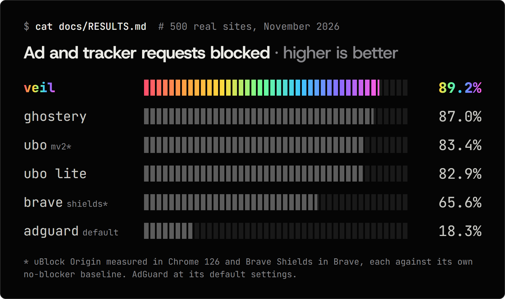

<p align="center">
  <picture>
    <source media="(prefers-color-scheme: dark)" srcset="docs/readme/logo-dark.png">
    
  </picture>
</p>

<h3 align="center">Out-blocks uBlock Origin. Free, open source, and silent.</h3>

<p align="center">
  
  
  
  
</p>

<p align="center">
  <a href="#install"><b>Install</b></a> &middot;
  <a href="#numbers"><b>Numbers</b></a> &middot;
  <a href="#why-its-different"><b>Why it's different</b></a> &middot;
  <a href="docs/RESULTS.md"><b>Full results</b></a>
</p>

<p align="center">
  
</p>

Veil is an ad and tracker blocker for Chrome, built for Manifest V3. We tested it against uBlock Origin, uBlock Origin Lite, Ghostery, AdGuard and Brave Shields on 500 real sites. **It blocked the most ad and tracker requests and let the fewest trackers through**, and it makes no network requests of its own unless you turn on list updates.

## Install

```bash
git clone https://github.com/goudacheeser/veil
```

```bash
cd veil && npm install && npm run build
```

Then open `chrome://extensions`, turn on **Developer mode**, click **Load unpacked** and choose the `dist/` folder.

Needs Chrome 137+ and Node 22+. A Chrome Web Store listing is coming soon.

## Numbers

| Measurement | Veil | Best of the rest | Result |
|---|---|---|---|
| Ad and tracker requests blocked | **89.2%** | Ghostery 87.0% | **Win** |
| Third-party trackers let through (lower is better) | **538** | Ghostery 604 | **Win** |
| Extra memory with 200 tabs open (lower is better)¹ | **538 MB** | AdGuard 1,448 MB | **Win** |
| Anti-adblock detectors passed, out of 7 | 7 | uBO, uBO Lite, Ghostery, Brave: 7 | Tie |
| Page-load speed-up vs. no blocker | 30.8% | uBO Lite 30.8%, 2 ms faster | Loss |
| Sites flagged for possible breakage (lower is better) | 4.7% | AdGuard 3.6% | Loss |

<sub>¹ uBlock Origin and Brave Shields weren't part of the memory test.</sub>

Where Veil loses:

- **Breakage.** A heuristic flagged 4.7% of sites for Veil, the most of the six. A manual re-check of every one found none that only Veil breaks ([review](docs/BREAKAGE_REVIEW.md)).
- **Speed.** uBlock Origin Lite loaded pages 2 ms faster at the median. Both made pages about 31% faster than no blocker.

How it was measured: each site was loaded with every blocker side by side. Whether a request counts as an ad or tracker is judged by public lists that Veil also ships, which favors Veil and uBlock Origin. uBlock Origin was measured in Chrome 126 (the last version that runs it without workarounds) and Brave Shields in Brave, each against its own no-blocker baseline. Every table and the raw per-request data are in [docs/RESULTS.md](docs/RESULTS.md).

## Why it's different

**Compiled, not interpreted.** Veil's own engine reads ABP and uBlock Origin filter syntax and compiles it into 117,507 Chrome `declarativeNetRequest` rules when the extension is built. Chrome applies them itself, so no extension code runs per request.

**Instant after every restart.** Chrome shuts down an MV3 extension's background worker whenever it goes idle. Veil's element-hiding filters live in a binary index that opens without parsing: 0.44 ms after a 2.7 ms file read, measured in Node.

**Silent by design.** Veil made no network requests in any benchmark or test run, and `test/integration.test.js` fails if it makes one. List updates are off until you turn them on, and are checked against an Ed25519 signature when you do.

**Benchmarks you can rerun.** The harness is in this repo, competitor builds are pinned by checksum, and every request from every page load is kept.

### One tracker, start to finish

The filter, from EasyPrivacy line 5961:

```
||scorecardresearch.com^$third-party
```

The rule Veil compiles it into:

```json
{ "action": { "type": "block" },
  "condition": { "urlFilter": "||scorecardresearch.com^", "domainType": "thirdParty" } }
```

What happened when the benchmark loaded nbcnews.com:

```
BLOCKED  script  sb.scorecardresearch.com/beacon.js
```

## What's inside

| Part | What it does |
|---|---|
| **Network filters** | `\|\|`, `^`, regex, and the `$options` MV3 can express, including `$redirect`, `$removeparam`, `$csp`, `$important`, `$badfilter`, `$denyallow` and `$to`. Built from EasyList, EasyPrivacy, the uBO lists, EasyList anti-adblock and Peter Lowe's list. |
| **Cosmetic filters** | Per-site and generic element hiding from a precompiled binary index. |
| **Procedural filters** | `:has-text`, `:matches-path`, `:upward`, `:matches-css`, `:matches-attr`, `:xpath`, `:remove`, `:style`, nested `:has` / `:not`. |
| **Scriptlets** | 46 scriptlets, registered per site so they run before the page's own scripts. |
| **Privacy** | No requests unless you turn on list updates, which are Ed25519-signed and SHA-256-checked. Every request Veil makes is listed on its options page. |
| **UI** | Popup with a per-site toggle, options page, a request logger that shows the matching filter, and an element picker. |

What it can't do: Manifest V3 rules out popup blocking, `$redirect-rule`, HTML filtering and a live blocked-count badge. Four procedural operators and 20 scriptlets aren't implemented yet. Full list with counts: [docs/LIMITATIONS.md](docs/LIMITATIONS.md).

<details>
<summary><b>Run the tests and benchmarks</b></summary>

```bash
npm test
npx @puppeteer/browsers install chrome@stable --path bench/.browsers
node --test test/integration.test.js
```

```bash
node bench/corpus/make-corpus.js
node bench/run.js --configs=none,veil,ubol,adguard,ghostery --run=myrun
node bench/analyze.js --run=myrun
node bench/antiadblock/run.js
node bench/microbench.js
node bench/memory.js --tabs=10,50,200
```

`npm run fetch-lists` downloads fresh filter lists; otherwise the build uses the hash-locked copies in `third_party/lists`. Competitor builds come from their official GitHub releases and are checked against `bench/competitors/SHA256SUMS`.

</details>

## No allowlists

Veil doesn't exempt any publisher in code. The only rules it ships beyond the public lists are the 11 in [`build/veil-defaults.txt`](build/veil-defaults.txt), which swap the scripts ad-block detectors probe for harmless stand-ins. None names a publisher, and the same rules exist in AdGuard Base and the uBO lists. Any exception is yours to add on the options page.

## Docs

[Architecture](docs/ARCHITECTURE.md) &middot; [Results](docs/RESULTS.md) &middot; [Breakage review](docs/BREAKAGE_REVIEW.md) &middot; [Limitations](docs/LIMITATIONS.md) &middot; [Threat model](docs/THREAT_MODEL.md) &middot; [Contributing](docs/CONTRIBUTING.md)

## License

[MIT](LICENSE) for Veil's code. The bundled filter lists keep their own licenses (GPL-3.0, CC BY-SA 3.0): see [THIRD_PARTY_LICENSES.md](THIRD_PARTY_LICENSES.md).
