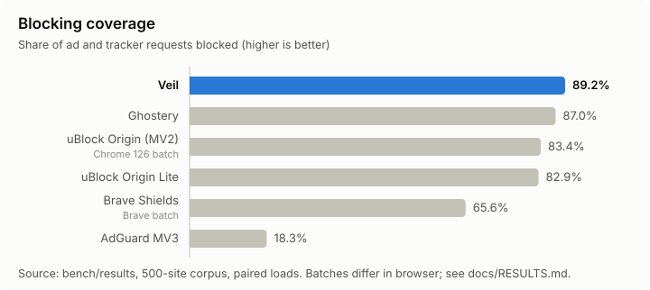
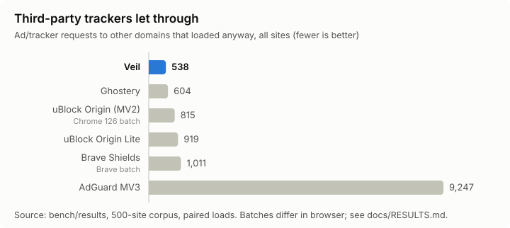
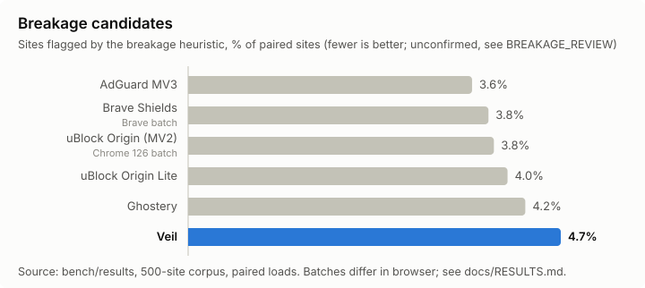
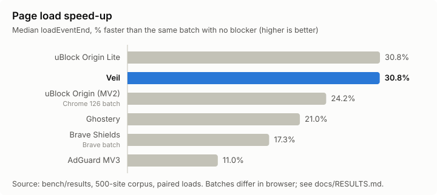
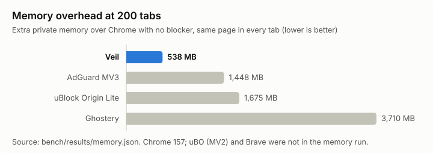

# Results

Generated 2026-11-10T22:56Z by `bench/report.js`. Every number below comes from a file under `bench/results/`; raw per-request data is under `bench/results/raw/<run>/`.

## Setup

* Corpus: `bench/corpus/corpus.json`, 500 sites (news 100, video 75, shopping 100, social 50, long-tail 175 sampled from Tranco ranks 5k–100k with seed 20261109).
* Host: Windows 11, 16 GB RAM, 16 threads. Browsers headless (new headless), 1366×900, normal desktop UA.
* Each site is loaded once per configuration, all configurations of a batch in parallel so they share network conditions. A site counts only if it reached DOMContentLoaded in every configuration of its batch.
* Reference classifier for "ad/tracker request": EasyList + EasyPrivacy + uBO filters/privacy/badware/unbreak/quick-fixes + EasyList anti-adblock + Peter Lowe + Fanboy Annoyance + uBO annoyances, compiled by Veil's parser, evaluated per request with page context (`bench/analyze.js`).
* Competitor builds: `bench/competitors/SHA256SUMS`. uBO 1.76 (MV2) runs in Chrome 126, the last Chrome that runs MV2 unconditionally, paired with a Chrome 126 no-blocker baseline, because Chrome 157 refuses MV2 extensions (and Brave only re-enables MV2 for store-signed IDs: an unpacked uBO loads there but blocks nothing). uBO Lite runs in its default "Basic" mode. Brave Shields are measured in Brave 157 against Brave with shields off.

## 1. Blocking coverage

### Run `batchA-chrome` (449 paired sites of 500)

| config | requests seen | ad/tracker requests | blocked | redirected | let through (false negatives) | of which third-party | coverage | non-ad requests blocked |
|---|---|---|---|---|---|---|---|---|
| none | 73591 | 24334 | 30 | 0 | 23985 | 22789 | 0.1% | 18 |
| veil | 50292 | 5623 | 5017 | 550 | 575 | 538 | 89.2% | 199 |
| ubol | 50065 | 5857 | 4856 | 652 | 972 | 919 | 82.9% | 371 |
| adguard | 59250 | 12713 | 2330 | 67 | 10307 | 9247 | 18.3% | 750 |
| ghostery | 50555 | 5436 | 4727 | 596 | 661 | 604 | 87% | 410 |

| category | none | veil | ubol | adguard | ghostery |
|---|---|---|---|---|---|
| news | 0% (0/10339) | 89.4% (1598/1787) | 81.7% (1592/1949) | 19.9% (1051/5284) | 87% (1702/1956) |
| video | 0.1% (4/6008) | 81.8% (656/802) | 80.6% (649/805) | 21.4% (403/1885) | 81.9% (657/802) |
| shopping | 0.6% (22/3640) | 94.7% (1734/1832) | 84.6% (1637/1936) | 13.6% (441/3242) | 89.9% (1411/1569) |
| social | 0.1% (1/1144) | 93% (278/299) | 92.2% (273/296) | 16% (84/524) | 94.4% (304/322) |
| longtail | 0.1% (3/3203) | 83.2% (751/903) | 80.9% (705/871) | 19.7% (351/1778) | 83% (653/787) |

False negatives by host (top 10):

* **veil**: geolocation.onetrust.com (73), global.ketchcdn.com (53), asset.fwcdn3.com (46), cdn.cookielaw.org (45), news.google.com (28), cdn-au.onetrust.com (26), cmp.osano.com (19), geo.privacymanager.io (15), static.addtoany.com (14), cdn-ukwest.onetrust.com (12)
* **ubol**: tags.tiqcdn.com (95), geolocation.onetrust.com (77), siteintercept.qualtrics.com (63), global.ketchcdn.com (51), cdn.cookielaw.org (46), asset.fwcdn3.com (45), 0.stg.pick.frostplant.me (40), news.google.com (33), cdn-ukwest.onetrust.com (30), cdn-au.onetrust.com (29)
* **adguard**: www.googletagmanager.com (741), www.google.com (516), connect.facebook.net (206), analytics.google.com (196), www.google-analytics.com (185), events.newsroom.bi (181), tags.tiqcdn.com (170), assets.adobedtm.com (167), gm.mmstat.com (160), bam.nr-data.net (159)
* **ghostery**: geolocation.onetrust.com (60), cdn.cookielaw.org (46), asset.fwcdn3.com (45), news.google.com (33), cdn-ukwest.onetrust.com (29), cmp.osano.com (19), 0.pick.frostplant.me (18), cdn-au.onetrust.com (15), tags.tiqcdn.com (14), static.addtoany.com (14)

### Run `batchB-brave` (451 paired sites of 500)

| config | requests seen | ad/tracker requests | blocked | redirected | let through (false negatives) | of which third-party | coverage | non-ad requests blocked |
|---|---|---|---|---|---|---|---|---|
| brave-none | 71444 | 23789 | 10 | 0 | 23406 | 22346 | 0% | 23 |
| brave | 49634 | 5494 | 3603 | 0 | 1869 | 1011 | 65.6% | 320 |

| category | brave-none | brave |
|---|---|---|
| news | 0% (0/10803) | 67.8% (1447/2135) |
| video | 0.1% (4/5134) | 61.8% (407/659) |
| shopping | 0.1% (2/3250) | 65.4% (1128/1724) |
| social | 0.1% (1/1142) | 67.4% (186/276) |
| longtail | 0.1% (3/3460) | 62.1% (435/700) |

False negatives by host (top 10):

* **brave**: www.googletagmanager.com (308), securepubads.g.doubleclick.net (92), aplus.aliexpress.us (52), www.wish.com (52), static.chartbeat.com (50), siteintercept.qualtrics.com (48), asset.fwcdn3.com (45), pagead2.googlesyndication.com (39), c.amazon-adsystem.com (33), news.google.com (32)

### Run `batchC-chrome126` (443 paired sites of 383)

| config | requests seen | ad/tracker requests | blocked | redirected | let through (false negatives) | of which third-party | coverage | non-ad requests blocked |
|---|---|---|---|---|---|---|---|---|
| none126 | 82771 | 27993 | 12 | 0 | 25407 | 24357 | 0% | 78 |
| ubo | 53198 | 5438 | 4537 | 609 | 857 | 815 | 83.4% | 384 |

| category | none126 | ubo |
|---|---|---|
| news | 0% (0/14208) | 84.9% (1594/1877) |
| video | 0.1% (5/5701) | 77.4% (651/841) |
| shopping | 0.1% (3/3413) | 85.3% (1422/1668) |
| social | 0.1% (1/970) | 93% (226/243) |
| longtail | 0.1% (3/3701) | 79.6% (644/809) |

False negatives by host (top 10):

* **ubo**: geolocation.onetrust.com (70), tags.tiqcdn.com (54), siteintercept.qualtrics.com (47), global.ketchcdn.com (46), asset.fwcdn3.com (46), cdn.cookielaw.org (40), news.google.com (33), cdn-au.onetrust.com (31), cdn-ukwest.onetrust.com (30), ad.doubleclick.net (22)

"Coverage" is blocked ÷ ad requests observed with that blocker installed. Third-party false negatives are the ones that matter most for tracking; first-party ones are mostly first-party analytics endpoints and ad-slot CSS on the publisher's own CDN.

## 2. Breakage candidates

Heuristic, relative to the no-blocker load of the same site in the same batch (text collapse >60 %, playable video lost, empty body, +5 JS errors, login link or comment section disappearing). Candidates need a human look at the screenshots in the raw run directory before being called breakage.

| config | run | candidates | % of paired sites |
|---|---|---|---|
| veil | batchA-chrome | 21 | 4.7% |
| ubol | batchA-chrome | 18 | 4% |
| adguard | batchA-chrome | 16 | 3.6% |
| ghostery | batchA-chrome | 19 | 4.2% |
| brave | batchB-brave | 17 | 3.8% |
| ubo | batchC-chrome126 | 17 | 3.8% |

veil (batchA-chrome) candidate list

* 4anime.gg (video): empty body
* anime.nexus (longtail): text 16065→285
* banggood.com (shopping): js errors 0→13
* behance.net (social): js errors 0→8
* bild.de (news): text 20746→1414
* dailymail.co.uk (news): login link gone; comment section gone
* deviantart.com (social): text 12598→406; login link gone
* fandom.com (social): js errors 0→7
* foxnews.com (news): js errors 1→8
* goerie.com (longtail): js errors 0→5
* iheart.com (video): video not playable
* kohls.com (shopping): text 21540→195; login link gone
* next.co.uk (shopping): video not playable
* nordstrom.com (shopping): js errors 0→10
* ranobes.com (longtail): text 2241→80; login link gone; comment section gone
* sfgate.com (news): login link gone
* telegraph.co.uk (news): text 2714→0; empty body; login link gone
* theguardian.com (news): js errors 0→19
* uol.com.br (news): login link gone
* youtube.com (video): login link gone
* zhihu.com (social): js errors 0→12

ubol (batchA-chrome) candidate list

* 4anime.gg (video): empty body
* anime.nexus (longtail): text 16065→285
* banggood.com (shopping): js errors 0→15
* behance.net (social): js errors 0→8
* cabelas.com (shopping): empty body
* dailymail.co.uk (news): login link gone; comment section gone
* deviantart.com (social): text 12598→406; login link gone
* fandom.com (social): js errors 0→7
* foxnews.com (news): js errors 1→7
* next.co.uk (shopping): video not playable
* nordstrom.com (shopping): js errors 0→8
* rumble.com (video): text 3920→426; video not playable
* sfgate.com (news): login link gone
* telegraph.co.uk (news): text 2714→0; empty body; login link gone
* theguardian.com (news): js errors 0→18
* underarmour.com (shopping): js errors 0→6
* uol.com.br (news): login link gone
* zhihu.com (social): js errors 0→11

adguard (batchA-chrome) candidate list

* 4anime.gg (video): empty body
* axios.com (news): js errors 0→7
* bild.de (news): text 20746→1414
* bsky.app (social): text 11210→4357
* cabelas.com (shopping): empty body
* dailymail.co.uk (news): login link gone; comment section gone
* g2a.com (shopping): empty body
* huffpost.com (news): js errors 0→29
* linkedin.com (social): text 2775→130; login link gone
* ranobes.com (longtail): text 2241→80; login link gone; comment section gone
* rumble.com (video): text 3920→426; video not playable
* sfgate.com (news): login link gone
* telegraph.co.uk (news): text 2714→0; empty body; login link gone
* underarmour.com (shopping): video not playable
* uol.com.br (news): login link gone
* youtube.com (video): login link gone

ghostery (batchA-chrome) candidate list

* 4anime.gg (video): empty body
* banggood.com (shopping): js errors 0→15
* behance.net (social): js errors 0→8
* bsky.app (social): text 11210→4357
* fandom.com (social): js errors 0→7
* foxnews.com (news): js errors 1→9
* g2a.com (shopping): empty body
* iheart.com (video): video not playable
* nordstrom.com (shopping): js errors 0→10
* rmg.co.uk (longtail): login link gone
* rumble.com (video): text 3920→15; video not playable
* sfgate.com (news): login link gone
* spiegel.de (news): js errors 0→5
* telegram.org (social): video not playable
* telegraph.co.uk (news): text 2714→0; empty body; login link gone
* theguardian.com (news): js errors 0→15
* uol.com.br (news): login link gone
* welt.de (news): js errors 0→19
* zhihu.com (social): js errors 0→12

brave (batchB-brave) candidate list

* 4anime.gg (video): empty body
* abcnews.go.com (news): comment section gone
* behance.net (social): js errors 0→7
* comparably.com (longtail): text 3454→134; login link gone; comment section gone
* dailymail.co.uk (news): empty body
* elpais.com (news): text 21703→0; login link gone
* fandom.com (social): js errors 0→7
* kroger.com (shopping): empty body; login link gone
* lanacion.com.ar (news): video not playable
* nbcnews.com (news): js errors 2→21
* odysee.com (video): comment section gone
* ok.ru (video): js errors 0→14
* rmg.co.uk (longtail): login link gone
* scmp.com (news): text 20504→7044; login link gone
* sfgate.com (news): login link gone
* uol.com.br (news): login link gone
* vudu.com (video): text 4862→368

ubo (batchC-chrome126) candidate list

* 4anime.gg (video): empty body
* banggood.com (shopping): js errors 0→9
* behance.net (social): js errors 0→8
* bild.de (news): text 20729→1414
* deviantart.com (social): text 13390→406; login link gone
* fandom.com (social): js errors 0→8
* foxnews.com (news): js errors 1→6
* gamesradar.com (video): text 8888→0; empty body; comment section gone
* imdb.com (video): login link gone
* kohls.com (shopping): empty body; login link gone
* kroger.com (shopping): text 3159→0; empty body; login link gone
* pcgamer.com (video): text 13671→0; empty body; comment section gone
* peacocktv.com (video): login link gone
* scmp.com (news): text 21198→7308; login link gone
* telegraph.co.uk (news): js errors 1→11
* theguardian.com (news): js errors 0→20
* zhihu.com (social): js errors 0→9

## 3. Performance

### Page load (navigation timing `loadEventEnd`, paired sites, ms)

| config | run | median | p95 | Δ median vs that batch's baseline | JS errors | loads that failed |
|---|---|---|---|---|---|---|
| none | batchA-chrome | 8359 | 23574 | 0 | 348 | 48 |
| veil | batchA-chrome | 5786 | 16020 | -2573 | 402 | 48 |
| ubol | batchA-chrome | 5784 | 16622 | -2575 | 419 | 48 |
| adguard | batchA-chrome | 7437 | 20316 | -921 | 380 | 48 |
| ghostery | batchA-chrome | 6601 | 18130 | -1758 | 427 | 46 |
| brave-none | batchB-brave | 3344 | 18448 | 0 | 282 | 46 |
| brave | batchB-brave | 2766 | 13639 | -578 | 374 | 48 |
| none126 | batchC-chrome126 | 3143 | 13603 | 0 | 330 | 52 |
| ubo | batchC-chrome126 | 2381 | 11719 | -762 | 380 | 53 |

Load times are dominated by the sites themselves and by whether ads were blocked (blocking usually makes pages faster); the Δ column is the honest signal and still has run-to-run noise of tens of milliseconds.

### Engine micro-benchmark (Node, `bench/microbench.js`)

| decisions | per-decision median | p95 | p99 | open network index (11.5 MB) | open cosmetic index (1.9 MB) | cosmetic hostname lookup median | generic lookup (20 classes) median |
|---|---|---|---|---|---|---|---|
| 74678 real URLs | 25.4 µs | 78 µs | 107.2 µs | 2.81 ms (+11.24 ms read) | 0.44 ms (+2.74 ms read) | 10.5 µs | 1.9 µs |

The 2 ms per-decision target is met by two orders of magnitude for the JS matcher. Live request decisions are made by Chromium's declarativeNetRequest engine, whose per-request cost is not observable from an extension; it is the same engine uBO Lite and AdGuard MV3 use.

### Memory and CPU at 10 / 50 / 200 tabs (`bench/memory.js`, identical local page in every tab)

| config | idle: private MB total (extension process) | tabs10: private MB total (extension process) | tabs50: private MB total (extension process) | tabs200: private MB total (extension process) | CPU ms total at max tabs (extension process) |
|---|---|---|---|---|---|
| none | 295 (0) | 684 (0) | 2118 (0) | 7349 (0) | 64563 (0) |
| veil | 374 (32) | 773 (37) | 2287 (39) | 7887 (35) | 72969 (734) |
| ubol | 403 (53) | 857 (53) | 2614 (53) | 9024 (0) | 86625 (0) |
| adguard | 1228 (702) | 1637 (700) | 2969 (377) | 8797 (199) | 117359 (10000) |
| ghostery | 601 (242) | 1370 (338) | 4015 (307) | 11059 (432) | 304984 (62344) |

same local page in every tab; all tabs share one renderer per site so content-script memory lands in that renderer; extension process = service worker + extension pages

## 4. Anti-adblock detection suite (`bench/antiadblock/run.js`)

Seven detector techniques (BlockAdBlock bait element, adsbygoogle load check, /ads.js and prebid baits, fetch bait, FuckAdBlock callbacks, missing BlockAdBlock library) on a local page that loads real ad hostnames via host-resolver rules. DETECTED = the site would show a wall. `_bait` rows show whether the bait was actually blocked (a blocker that lets the bait through "passes" trivially).

| detector | none | veil | ubol | adguard | ghostery | none126 | ubo | brave-none | brave |
|---|---|---|---|---|---|---|---|---|---|
| fetch-bait | passed | passed | passed | **DETECTED** | passed | passed | passed | passed | passed |
| bait-element | passed | passed | passed | passed | passed | passed | passed | passed | passed |
| adsbygoogle-loaded | passed | passed | passed | **DETECTED** | passed | passed | passed | passed | passed |
| ads-js-bait | passed | passed | passed | passed | passed | passed | passed | passed | passed |
| prebid-bait | passed | passed | passed | passed | passed | passed | passed | passed | passed |
| fuckadblock | passed | passed | passed | passed | passed | passed | passed | passed | passed |
| blockadblock-lib-missing | passed | passed | passed | passed | passed | passed | passed | passed | passed |
| _bait: adsbygoogle.js fetched from network | loaded | stopped | stopped | stopped | loaded | loaded | stopped | loaded | stopped |
| _bait: ads.js fetched from network | loaded | stopped | loaded | loaded | loaded | loaded | loaded | loaded | loaded |
| _bait: blockadblock.js fetched from network | loaded | stopped | stopped | loaded | loaded | loaded | stopped | loaded | loaded |

## 5. Privacy

* Veil made **0** network requests during every benchmark and test run (`storage.netlog` empty; asserted by `test/integration.test.js`). The updater is off by default; when enabled it fetches `lists.lock.json` + an Ed25519 signature from the user-configured URL, then the lists, verifying SHA-256 against the signed lock.
* Per-request records in the raw data contain every URL each browser requested; none go to a Veil-controlled host because there is none.

## 6. Filter engine coverage of list syntax

From `build/build-report.json` for the bundled list snapshot: 125844 network filters, 74049 cosmetic filters, 11836 hostname→scriptlet rules compiled; 117507 DNR rules enabled by default (121876 total). Not expressible: [object Object],[object Object],[object Object],[object Object],[object Object],[object Object],[object Object],[object Object],[object Object],[object Object],[object Object],[object Object],[object Object],[object Object],[object Object],[object Object],[object Object],[object Object],[object Object],[object Object],[object Object],[object Object],[object Object],[object Object],[object Object],[object Object],[object Object],[object Object],[object Object],[object Object],[object Object],[object Object],[object Object],[object Object],[object Object],[object Object],[object Object],[object Object],[object Object],[object Object],[object Object],[object Object],[object Object],[object Object],[object Object],[object Object],[object Object],[object Object],[object Object],[object Object],[object Object],[object Object],[object Object],[object Object],[object Object],[object Object],[object Object],[object Object],[object Object],[object Object],[object Object],[object Object],[object Object],[object Object],[object Object],[object Object],[object Object],[object Object],[object Object],[object Object],[object Object],[object Object],[object Object],[object Object],[object Object],[object Object],[object Object],[object Object],[object Object],[object Object],[object Object],[object Object],[object Object],[object Object],[object Object],[object Object],[object Object],[object Object],[object Object],[object Object],[object Object],[object Object],[object Object],[object Object],[object Object],[object Object],[object Object],[object Object],[object Object],[object Object],[object Object],[object Object],[object Object],[object Object],[object Object],[object Object],[object Object],[object Object],[object Object],[object Object],[object Object],[object Object],[object Object],[object Object],[object Object],[object Object],[object Object],[object Object],[object Object],[object Object],[object Object],[object Object],[object Object],[object Object],[object Object],[object Object],[object Object],[object Object],[object Object],[object Object],[object Object],[object Object],[object Object],[object Object],[object Object],[object Object],[object Object],[object Object],[object Object],[object Object],[object Object],[object Object],[object Object],[object Object],[object Object],[object Object],[object Object],[object Object],[object Object],[object Object],[object Object],[object Object],[object Object],[object Object],[object Object],[object Object],[object Object],[object Object],[object Object],[object Object],[object Object],[object Object],[object Object],[object Object],[object Object],[object Object],[object Object],[object Object],[object Object],[object Object],[object Object],[object Object],[object Object],[object Object],[object Object],[object Object],[object Object],[object Object],[object Object],[object Object],[object Object],[object Object],[object Object],[object Object],[object Object],[object Object],[object Object],[object Object],[object Object],[object Object],[object Object],[object Object],[object Object],[object Object],[object Object],[object Object],[object Object],[object Object],[object Object],[object Object],[object Object],[object Object],[object Object],[object Object],[object Object],[object Object],[object Object],[object Object],[object Object],[object Object],[object Object],[object Object],[object Object],[object Object],[object Object],[object Object],[object Object],[object Object],[object Object],[object Object],[object Object],[object Object],[object Object],[object Object],[object Object],[object Object],[object Object],[object Object],[object Object],[object Object],[object Object],[object Object],[object Object],[object Object],[object Object],[object Object],[object Object],[object Object],[object Object],[object Object],[object Object],[object Object],[object Object],[object Object],[object Object],[object Object],[object Object],[object Object],[object Object],[object Object],[object Object],[object Object],[object Object],[object Object],[object Object],[object Object],[object Object],[object Object],[object Object],[object Object],[object Object],[object Object],[object Object],[object Object],[object Object],[object Object],[object Object],[object Object],[object Object],[object Object],[object Object],[object Object],[object Object],[object Object],[object Object],[object Object],[object Object],[object Object],[object Object],[object Object],[object Object],[object Object],[object Object],[object Object],[object Object],[object Object],[object Object],[object Object],[object Object],[object Object],[object Object],[object Object],[object Object],[object Object],[object Object],[object Object],[object Object],[object Object],[object Object],[object Object],[object Object],[object Object],[object Object],[object Object],[object Object],[object Object],[object Object],[object Object],[object Object],[object Object],[object Object],[object Object],[object Object],[object Object],[object Object],[object Object],[object Object],[object Object],[object Object],[object Object],[object Object],[object Object],[object Object],[object Object],[object Object],[object Object],[object Object],[object Object],[object Object],[object Object],[object Object],[object Object],[object Object],[object Object],[object Object],[object Object],[object Object],[object Object],[object Object],[object Object],[object Object],[object Object],[object Object],[object Object],[object Object],[object Object],[object Object],[object Object],[object Object],[object Object],[object Object],[object Object],[object Object],[object Object],[object Object],[object Object],[object Object],[object Object],[object Object],[object Object],[object Object],[object Object],[object Object],[object Object],[object Object],[object Object],[object Object],[object Object],[object Object],[object Object],[object Object],[object Object],[object Object],[object Object],[object Object],[object Object],[object Object],[object Object],[object Object],[object Object],[object Object],[object Object],[object Object],[object Object],[object Object],[object Object],[object Object],[object Object],[object Object],[object Object],[object Object],[object Object],[object Object],[object Object],[object Object],[object Object],[object Object],[object Object],[object Object],[object Object],[object Object],[object Object],[object Object],[object Object],[object Object],[object Object],[object Object],[object Object],[object Object],[object Object],[object Object],[object Object],[object Object],[object Object],[object Object],[object Object],[object Object],[object Object],[object Object],[object Object],[object Object],[object Object],[object Object],[object Object],[object Object],[object Object],[object Object],[object Object],[object Object],[object Object],[object Object],[object Object],[object Object],[object Object],[object Object],[object Object],[object Object],[object Object],[object Object],[object Object],[object Object],[object Object],[object Object],[object Object],[object Object],[object Object],[object Object],[object Object],[object Object],[object Object],[object Object],[object Object],[object Object],[object Object],[object Object],[object Object],[object Object],[object Object],[object Object],[object Object],[object Object],[object Object],[object Object],[object Object],[object Object],[object Object],[object Object],[object Object],[object Object],[object Object],[object Object],[object Object],[object Object],[object Object],[object Object],[object Object],[object Object],[object Object],[object Object],[object Object],[object Object],[object Object],[object Object],[object Object],[object Object],[object Object],[object Object],[object Object],[object Object],[object Object],[object Object],[object Object],[object Object],[object Object],[object Object],[object Object],[object Object],[object Object],[object Object],[object Object],[object Object],[object Object],[object Object],[object Object],[object Object],[object Object],[object Object],[object Object],[object Object],[object Object],[object Object],[object Object],[object Object],[object Object],[object Object],[object Object],[object Object],[object Object],[object Object],[object Object],[object Object],[object Object],[object Object],[object Object],[object Object],[object Object],[object Object],[object Object],[object Object],[object Object],[object Object],[object Object],[object Object],[object Object],[object Object],[object Object],[object Object],[object Object],[object Object],[object Object],[object Object],[object Object],[object Object],[object Object],[object Object],[object Object],[object Object],[object Object],[object Object],[object Object],[object Object],[object Object],[object Object],[object Object],[object Object],[object Object],[object Object],[object Object],[object Object],[object Object],[object Object],[object Object],[object Object],[object Object],[object Object],[object Object],[object Object],[object Object],[object Object],[object Object],[object Object],[object Object],[object Object],[object Object],[object Object],[object Object],[object Object],[object Object],[object Object],[object Object],[object Object],[object Object],[object Object],[object Object],[object Object],[object Object],[object Object],[object Object],[object Object],[object Object],[object Object],[object Object],[object Object],[object Object],[object Object],[object Object],[object Object],[object Object],[object Object],[object Object],[object Object],[object Object],[object Object],[object Object],[object Object],[object Object],[object Object],[object Object],[object Object],[object Object],[object Object],[object Object],[object Object],[object Object],[object Object],[object Object],[object Object],[object Object],[object Object],[object Object],[object Object],[object Object],[object Object],[object Object],[object Object],[object Object],[object Object],[object Object],[object Object],[object Object],[object Object],[object Object],[object Object],[object Object],[object Object],[object Object],[object Object],[object Object],[object Object],[object Object],[object Object],[object Object],[object Object],[object Object],[object Object],[object Object],[object Object],[object Object],[object Object],[object Object],[object Object],[object Object],[object Object],[object Object],[object Object],[object Object],[object Object],[object Object],[object Object],[object Object],[object Object],[object Object],[object Object],[object Object],[object Object],[object Object],[object Object],[object Object],[object Object],[object Object],[object Object],[object Object],[object Object],[object Object],[object Object],[object Object],[object Object],[object Object],[object Object],[object Object],[object Object],[object Object],[object Object],[object Object],[object Object],[object Object],[object Object],[object Object],[object Object],[object Object],[object Object],[object Object],[object Object],[object Object],[object Object],[object Object],[object Object],[object Object],[object Object],[object Object],[object Object],[object Object],[object Object],[object Object],[object Object],[object Object],[object Object],[object Object],[object Object],[object Object],[object Object],[object Object],[object Object],[object Object],[object Object],[object Object],[object Object],[object Object],[object Object],[object Object],[object Object],[object Object],[object Object],[object Object],[object Object],[object Object],[object Object],[object Object],[object Object],[object Object],[object Object],[object Object],[object Object],[object Object],[object Object],[object Object],[object Object],[object Object],[object Object],[object Object],[object Object],[object Object],[object Object],[object Object],[object Object],[object Object],[object Object],[object Object],[object Object],[object Object],[object Object],[object Object],[object Object],[object Object],[object Object],[object Object],[object Object],[object Object],[object Object],[object Object],[object Object],[object Object],[object Object],[object Object],[object Object],[object Object],[object Object],[object Object],[object Object],[object Object],[object Object],[object Object],[object Object],[object Object],[object Object],[object Object],[object Object],[object Object],[object Object],[object Object],[object Object],[object Object],[object Object],[object Object],[object Object],[object Object],[object Object],[object Object],[object Object],[object Object],[object Object],[object Object],[object Object],[object Object],[object Object],[object Object],[object Object],[object Object],[object Object],[object Object],[object Object],[object Object],[object Object],[object Object],[object Object],[object Object],[object Object],[object Object],[object Object],[object Object],[object Object],[object Object],[object Object],[object Object],[object Object],[object Object],[object Object],[object Object],[object Object],[object Object],[object Object],[object Object],[object Object],[object Object],[object Object],[object Object],[object Object],[object Object],[object Object],[object Object],[object Object],[object Object],[object Object],[object Object],[object Object],[object Object],[object Object],[object Object],[object Object],[object Object],[object Object],[object Object],[object Object],[object Object],[object Object],[object Object],[object Object],[object Object],[object Object],[object Object],[object Object],[object Object],[object Object],[object Object],[object Object],[object Object],[object Object],[object Object],[object Object],[object Object],[object Object],[object Object],[object Object],[object Object],[object Object],[object Object],[object Object],[object Object],[object Object],[object Object],[object Object],[object Object],[object Object],[object Object],[object Object],[object Object],[object Object],[object Object],[object Object],[object Object],[object Object],[object Object],[object Object],[object Object],[object Object],[object Object],[object Object],[object Object],[object Object],[object Object],[object Object],[object Object],[object Object],[object Object],[object Object],[object Object],[object Object],[object Object],[object Object],[object Object],[object Object],[object Object],[object Object],[object Object],[object Object],[object Object],[object Object],[object Object],[object Object],[object Object],[object Object],[object Object],[object Object],[object Object],[object Object],[object Object],[object Object],[object Object],[object Object],[object Object],[object Object],[object Object],[object Object],[object Object],[object Object],[object Object],[object Object],[object Object],[object Object],[object Object],[object Object],[object Object],[object Object],[object Object],[object Object],[object Object],[object Object],[object Object],[object Object],[object Object],[object Object],[object Object],[object Object],[object Object],[object Object],[object Object],[object Object],[object Object],[object Object],[object Object],[object Object],[object Object],[object Object],[object Object],[object Object],[object Object],[object Object],[object Object],[object Object],[object Object],[object Object],[object Object],[object Object],[object Object],[object Object],[object Object],[object Object],[object Object],[object Object],[object Object],[object Object],[object Object],[object Object],[object Object],[object Object],[object Object],[object Object],[object Object],[object Object],[object Object],[object Object],[object Object],[object Object],[object Object],[object Object],[object Object],[object Object],[object Object],[object Object],[object Object],[object Object],[object Object],[object Object],[object Object],[object Object],[object Object],[object Object],[object Object],[object Object],[object Object],[object Object],[object Object],[object Object],[object Object],[object Object],[object Object],[object Object],[object Object],[object Object],[object Object],[object Object],[object Object],[object Object],[object Object],[object Object],[object Object],[object Object],[object Object],[object Object],[object Object],[object Object],[object Object],[object Object],[object Object],[object Object],[object Object],[object Object],[object Object],[object Object],[object Object],[object Object],[object Object],[object Object],[object Object],[object Object],[object Object],[object Object],[object Object],[object Object],[object Object],[object Object],[object Object],[object Object],[object Object],[object Object],[object Object],[object Object],[object Object],[object Object],[object Object],[object Object],[object Object],[object Object],[object Object],[object Object],[object Object],[object Object],[object Object],[object Object],[object Object],[object Object],[object Object],[object Object],[object Object],[object Object],[object Object],[object Object],[object Object],[object Object],[object Object],[object Object],[object Object],[object Object],[object Object],[object Object],[object Object],[object Object],[object Object],[object Object],[object Object],[object Object],[object Object],[object Object],[object Object],[object Object],[object Object],[object Object],[object Object],[object Object],[object Object],[object Object],[object Object],[object Object],[object Object],[object Object],[object Object],[object Object],[object Object],[object Object],[object Object],[object Object],[object Object],[object Object],[object Object],[object Object],[object Object],[object Object],[object Object],[object Object],[object Object],[object Object],[object Object],[object Object],[object Object],[object Object],[object Object],[object Object],[object Object],[object Object],[object Object],[object Object],[object Object],[object Object],[object Object],[object Object],[object Object],[object Object],[object Object],[object Object],[object Object],[object Object],[object Object],[object Object],[object Object],[object Object],[object Object],[object Object],[object Object],[object Object],[object Object],[object Object],[object Object],[object Object],[object Object],[object Object],[object Object],[object Object],[object Object],[object Object],[object Object],[object Object],[object Object],[object Object],[object Object],[object Object],[object Object],[object Object],[object Object],[object Object],[object Object],[object Object],[object Object],[object Object],[object Object],[object Object],[object Object],[object Object],[object Object],[object Object],[object Object],[object Object],[object Object],[object Object],[object Object],[object Object],[object Object],[object Object],[object Object],[object Object],[object Object],[object Object],[object Object],[object Object],[object Object],[object Object],[object Object],[object Object],[object Object],[object Object],[object Object],[object Object],[object Object],[object Object],[object Object],[object Object],[object Object],[object Object],[object Object],[object Object],[object Object],[object Object],[object Object],[object Object],[object Object],[object Object],[object Object],[object Object],[object Object],[object Object],[object Object],[object Object],[object Object],[object Object],[object Object],[object Object],[object Object],[object Object],[object Object],[object Object],[object Object],[object Object],[object Object],[object Object],[object Object],[object Object],[object Object],[object Object],[object Object],[object Object],[object Object],[object Object],[object Object],[object Object],[object Object],[object Object],[object Object],[object Object],[object Object],[object Object],[object Object],[object Object],[object Object],[object Object],[object Object],[object Object],[object Object],[object Object],[object Object],[object Object],[object Object],[object Object],[object Object],[object Object],[object Object],[object Object],[object Object],[object Object],[object Object],[object Object],[object Object],[object Object],[object Object],[object Object],[object Object],[object Object],[object Object],[object Object],[object Object],[object Object],[object Object],[object Object],[object Object],[object Object],[object Object],[object Object],[object Object],[object Object],[object Object],[object Object],[object Object],[object Object],[object Object],[object Object],[object Object],[object Object],[object Object],[object Object],[object Object],[object Object],[object Object],[object Object],[object Object],[object Object],[object Object],[object Object],[object Object],[object Object],[object Object],[object Object],[object Object],[object Object],[object Object],[object Object],[object Object],[object Object],[object Object],[object Object],[object Object],[object Object],[object Object],[object Object],[object Object],[object Object],[object Object],[object Object],[object Object],[object Object],[object Object],[object Object],[object Object],[object Object],[object Object],[object Object],[object Object],[object Object],[object Object],[object Object],[object Object],[object Object],[object Object],[object Object],[object Object],[object Object],[object Object],[object Object],[object Object],[object Object],[object Object],[object Object],[object Object],[object Object],[object Object],[object Object],[object Object],[object Object],[object Object],[object Object],[object Object],[object Object],[object Object],[object Object],[object Object],[object Object],[object Object],[object Object],[object Object],[object Object],[object Object],[object Object],[object Object],[object Object],[object Object],[object Object],[object Object],[object Object],[object Object],[object Object],[object Object],[object Object],[object Object],[object Object],[object Object],[object Object],[object Object],[object Object],[object Object],[object Object],[object Object],[object Object],[object Object],[object Object],[object Object],[object Object],[object Object],[object Object],[object Object],[object Object],[object Object],[object Object],[object Object],[object Object],[object Object],[object Object],[object Object],[object Object],[object Object],[object Object],[object Object],[object Object],[object Object],[object Object],[object Object],[object Object],[object Object],[object Object],[object Object],[object Object],[object Object],[object Object],[object Object],[object Object],[object Object],[object Object],[object Object],[object Object],[object Object],[object Object],[object Object],[object Object],[object Object],[object Object],[object Object],[object Object],[object Object],[object Object],[object Object],[object Object],[object Object],[object Object],[object Object],[object Object],[object Object],[object Object],[object Object],[object Object],[object Object],[object Object],[object Object],[object Object],[object Object],[object Object],[object Object],[object Object],[object Object],[object Object],[object Object],[object Object],[object Object],[object Object],[object Object],[object Object],[object Object],[object Object],[object Object],[object Object],[object Object],[object Object],[object Object],[object Object],[object Object],[object Object],[object Object],[object Object],[object Object],[object Object],[object Object],[object Object],[object Object],[object Object],[object Object],[object Object],[object Object],[object Object],[object Object],[object Object],[object Object],[object Object],[object Object],[object Object],[object Object],[object Object],[object Object],[object Object],[object Object],[object Object],[object Object],[object Object],[object Object],[object Object],[object Object],[object Object],[object Object],[object Object],[object Object],[object Object],[object Object],[object Object],[object Object],[object Object],[object Object],[object Object],[object Object],[object Object],[object Object],[object Object],[object Object],[object Object],[object Object],[object Object],[object Object],[object Object],[object Object],[object Object],[object Object],[object Object],[object Object],[object Object],[object Object],[object Object],[object Object],[object Object],[object Object],[object Object],[object Object],[object Object],[object Object],[object Object],[object Object],[object Object],[object Object],[object Object],[object Object],[object Object],[object Object],[object Object],[object Object],[object Object],[object Object],[object Object],[object Object],[object Object],[object Object],[object Object],[object Object],[object Object],[object Object],[object Object],[object Object],[object Object],[object Object],[object Object],[object Object],[object Object],[object Object],[object Object],[object Object],[object Object],[object Object],[object Object],[object Object],[object Object],[object Object],[object Object],[object Object],[object Object],[object Object],[object Object],[object Object],[object Object],[object Object],[object Object],[object Object],[object Object],[object Object],[object Object],[object Object],[object Object],[object Object],[object Object],[object Object],[object Object],[object Object],[object Object],[object Object],[object Object],[object Object],[object Object],[object Object],[object Object],[object Object],[object Object],[object Object],[object Object],[object Object],[object Object],[object Object],[object Object],[object Object],[object Object],[object Object],[object Object],[object Object],[object Object],[object Object],[object Object],[object Object],[object Object],[object Object],[object Object],[object Object],[object Object],[object Object],[object Object],[object Object],[object Object],[object Object],[object Object],[object Object],[object Object],[object Object],[object Object],[object Object],[object Object],[object Object],[object Object],[object Object],[object Object],[object Object],[object Object],[object Object],[object Object],[object Object],[object Object],[object Object],[object Object],[object Object],[object Object],[object Object],[object Object],[object Object],[object Object],[object Object],[object Object],[object Object],[object Object],[object Object] lines (parser) + [object Object],[object Object],[object Object],[object Object],[object Object],[object Object],[object Object],[object Object],[object Object],[object Object],[object Object],[object Object],[object Object],[object Object],[object Object],[object Object],[object Object],[object Object],[object Object],[object Object],[object Object],[object Object],[object Object],[object Object],[object Object],[object Object],[object Object],[object Object],[object Object],[object Object],[object Object],[object Object],[object Object],[object Object],[object Object],[object Object],[object Object],[object Object],[object Object],[object Object],[object Object],[object Object],[object Object],[object Object],[object Object],[object Object],[object Object],[object Object],[object Object],[object Object],[object Object],[object Object],[object Object],[object Object],[object Object],[object Object],[object Object],[object Object],[object Object],[object Object],[object Object],[object Object],[object Object],[object Object],[object Object],[object Object],[object Object],[object Object],[object Object],[object Object],[object Object],[object Object],[object Object],[object Object],[object Object],[object Object],[object Object],[object Object],[object Object],[object Object],[object Object],[object Object],[object Object],[object Object],[object Object],[object Object],[object Object],[object Object],[object Object],[object Object],[object Object],[object Object],[object Object],[object Object],[object Object],[object Object],[object Object],[object Object],[object Object],[object Object],[object Object],[object Object],[object Object],[object Object],[object Object],[object Object],[object Object],[object Object],[object Object],[object Object],[object Object],[object Object],[object Object],[object Object],[object Object],[object Object],[object Object],[object Object],[object Object],[object Object],[object Object],[object Object],[object Object],[object Object],[object Object],[object Object],[object Object],[object Object],[object Object],[object Object],[object Object],[object Object],[object Object],[object Object],[object Object],[object Object],[object Object],[object Object],[object Object],[object Object],[object Object],[object Object],[object Object],[object Object],[object Object],[object Object],[object Object],[object Object],[object Object],[object Object],[object Object],[object Object],[object Object],[object Object],[object Object],[object Object],[object Object],[object Object],[object Object],[object Object],[object Object],[object Object],[object Object],[object Object],[object Object],[object Object],[object Object],[object Object],[object Object],[object Object],[object Object],[object Object],[object Object],[object Object],[object Object],[object Object],[object Object],[object Object],[object Object],[object Object],[object Object],[object Object],[object Object],[object Object],[object Object],[object Object],[object Object],[object Object],[object Object],[object Object],[object Object],[object Object],[object Object],[object Object],[object Object],[object Object],[object Object],[object Object],[object Object],[object Object],[object Object],[object Object],[object Object],[object Object],[object Object],[object Object],[object Object],[object Object],[object Object],[object Object],[object Object],[object Object],[object Object],[object Object],[object Object],[object Object],[object Object],[object Object],[object Object],[object Object],[object Object],[object Object],[object Object],[object Object],[object Object],[object Object],[object Object],[object Object],[object Object],[object Object],[object Object],[object Object],[object Object],[object Object],[object Object],[object Object],[object Object],[object Object],[object Object],[object Object],[object Object],[object Object],[object Object],[object Object],[object Object],[object Object],[object Object],[object Object],[object Object],[object Object],[object Object],[object Object],[object Object],[object Object],[object Object],[object Object],[object Object],[object Object],[object Object],[object Object],[object Object],[object Object],[object Object],[object Object],[object Object],[object Object],[object Object],[object Object],[object Object],[object Object],[object Object],[object Object],[object Object],[object Object],[object Object],[object Object],[object Object],[object Object],[object Object],[object Object],[object Object],[object Object],[object Object],[object Object],[object Object],[object Object],[object Object],[object Object],[object Object],[object Object],[object Object],[object Object],[object Object],[object Object],[object Object],[object Object],[object Object],[object Object],[object Object],[object Object],[object Object],[object Object],[object Object],[object Object],[object Object],[object Object],[object Object],[object Object],[object Object],[object Object],[object Object],[object Object],[object Object],[object Object],[object Object],[object Object],[object Object],[object Object],[object Object],[object Object],[object Object],[object Object],[object Object],[object Object],[object Object],[object Object],[object Object],[object Object],[object Object],[object Object],[object Object],[object Object],[object Object],[object Object],[object Object],[object Object],[object Object],[object Object],[object Object],[object Object],[object Object],[object Object],[object Object],[object Object],[object Object],[object Object],[object Object],[object Object],[object Object],[object Object],[object Object],[object Object],[object Object],[object Object],[object Object],[object Object],[object Object],[object Object],[object Object],[object Object],[object Object],[object Object],[object Object],[object Object],[object Object],[object Object],[object Object],[object Object],[object Object],[object Object],[object Object],[object Object],[object Object],[object Object],[object Object],[object Object],[object Object],[object Object],[object Object],[object Object],[object Object],[object Object],[object Object],[object Object],[object Object],[object Object],[object Object],[object Object],[object Object],[object Object],[object Object],[object Object],[object Object],[object Object],[object Object],[object Object],[object Object],[object Object],[object Object],[object Object],[object Object],[object Object],[object Object],[object Object],[object Object],[object Object],[object Object],[object Object],[object Object],[object Object],[object Object],[object Object],[object Object],[object Object],[object Object],[object Object],[object Object],[object Object],[object Object],[object Object],[object Object],[object Object],[object Object],[object Object],[object Object],[object Object],[object Object],[object Object],[object Object],[object Object],[object Object],[object Object],[object Object],[object Object],[object Object],[object Object],[object Object],[object Object],[object Object],[object Object],[object Object],[object Object],[object Object],[object Object],[object Object],[object Object],[object Object],[object Object],[object Object],[object Object],[object Object],[object Object],[object Object],[object Object],[object Object],[object Object],[object Object],[object Object],[object Object],[object Object],[object Object],[object Object],[object Object],[object Object],[object Object],[object Object],[object Object],[object Object],[object Object],[object Object],[object Object],[object Object],[object Object],[object Object],[object Object],[object Object],[object Object],[object Object],[object Object],[object Object],[object Object],[object Object],[object Object],[object Object],[object Object],[object Object],[object Object],[object Object],[object Object],[object Object],[object Object],[object Object],[object Object],[object Object],[object Object],[object Object],[object Object],[object Object],[object Object],[object Object],[object Object],[object Object],[object Object],[object Object],[object Object],[object Object],[object Object],[object Object],[object Object],[object Object],[object Object],[object Object],[object Object],[object Object],[object Object],[object Object],[object Object],[object Object],[object Object],[object Object],[object Object],[object Object],[object Object],[object Object],[object Object],[object Object],[object Object],[object Object],[object Object],[object Object],[object Object],[object Object],[object Object],[object Object],[object Object],[object Object],[object Object],[object Object],[object Object],[object Object],[object Object],[object Object],[object Object],[object Object],[object Object],[object Object],[object Object],[object Object],[object Object],[object Object],[object Object],[object Object],[object Object],[object Object],[object Object],[object Object],[object Object],[object Object],[object Object],[object Object],[object Object],[object Object],[object Object],[object Object],[object Object],[object Object],[object Object],[object Object],[object Object],[object Object],[object Object],[object Object],[object Object],[object Object],[object Object],[object Object],[object Object],[object Object],[object Object],[object Object],[object Object],[object Object],[object Object],[object Object],[object Object],[object Object],[object Object],[object Object],[object Object],[object Object],[object Object],[object Object],[object Object],[object Object],[object Object],[object Object],[object Object],[object Object],[object Object],[object Object],[object Object],[object Object],[object Object],[object Object],[object Object],[object Object],[object Object],[object Object],[object Object],[object Object],[object Object],[object Object],[object Object],[object Object],[object Object],[object Object],[object Object],[object Object],[object Object],[object Object],[object Object],[object Object],[object Object],[object Object],[object Object],[object Object],[object Object],[object Object],[object Object],[object Object],[object Object],[object Object],[object Object],[object Object],[object Object],[object Object],[object Object],[object Object],[object Object],[object Object],[object Object],[object Object],[object Object],[object Object],[object Object],[object Object],[object Object],[object Object],[object Object],[object Object],[object Object],[object Object],[object Object],[object Object],[object Object],[object Object],[object Object],[object Object],[object Object],[object Object],[object Object],[object Object],[object Object],[object Object],[object Object],[object Object],[object Object],[object Object],[object Object],[object Object],[object Object],[object Object],[object Object],[object Object],[object Object],[object Object],[object Object],[object Object],[object Object],[object Object],[object Object],[object Object],[object Object],[object Object],[object Object],[object Object],[object Object],[object Object],[object Object],[object Object],[object Object],[object Object],[object Object],[object Object],[object Object],[object Object],[object Object],[object Object],[object Object],[object Object],[object Object],[object Object],[object Object],[object Object],[object Object],[object Object],[object Object],[object Object],[object Object],[object Object],[object Object],[object Object],[object Object],[object Object],[object Object],[object Object],[object Object],[object Object],[object Object],[object Object],[object Object],[object Object],[object Object],[object Object],[object Object],[object Object],[object Object],[object Object],[object Object],[object Object],[object Object],[object Object],[object Object],[object Object],[object Object],[object Object],[object Object],[object Object],[object Object],[object Object],[object Object],[object Object],[object Object],[object Object],[object Object],[object Object],[object Object],[object Object],[object Object],[object Object],[object Object],[object Object],[object Object],[object Object],[object Object],[object Object],[object Object],[object Object],[object Object],[object Object],[object Object],[object Object],[object Object],[object Object],[object Object],[object Object],[object Object],[object Object],[object Object],[object Object],[object Object],[object Object],[object Object],[object Object],[object Object],[object Object],[object Object],[object Object],[object Object],[object Object],[object Object],[object Object],[object Object],[object Object],[object Object],[object Object],[object Object],[object Object],[object Object],[object Object],[object Object],[object Object],[object Object],[object Object],[object Object],[object Object],[object Object],[object Object],[object Object],[object Object],[object Object],[object Object],[object Object],[object Object],[object Object],[object Object],[object Object],[object Object],[object Object],[object Object],[object Object],[object Object],[object Object],[object Object],[object Object],[object Object],[object Object],[object Object],[object Object],[object Object],[object Object],[object Object],[object Object],[object Object],[object Object],[object Object],[object Object],[object Object],[object Object],[object Object],[object Object],[object Object],[object Object],[object Object],[object Object],[object Object],[object Object],[object Object],[object Object],[object Object],[object Object],[object Object],[object Object],[object Object],[object Object],[object Object],[object Object],[object Object],[object Object],[object Object],[object Object],[object Object],[object Object],[object Object],[object Object],[object Object],[object Object],[object Object],[object Object],[object Object],[object Object],[object Object],[object Object],[object Object],[object Object],[object Object],[object Object],[object Object],[object Object],[object Object],[object Object],[object Object],[object Object],[object Object],[object Object],[object Object],[object Object],[object Object],[object Object],[object Object],[object Object],[object Object],[object Object],[object Object],[object Object],[object Object],[object Object],[object Object],[object Object],[object Object],[object Object],[object Object],[object Object],[object Object],[object Object],[object Object],[object Object],[object Object],[object Object],[object Object],[object Object],[object Object],[object Object],[object Object],[object Object],[object Object],[object Object],[object Object],[object Object],[object Object],[object Object],[object Object],[object Object],[object Object],[object Object],[object Object],[object Object],[object Object],[object Object],[object Object],[object Object],[object Object],[object Object],[object Object],[object Object],[object Object],[object Object],[object Object],[object Object],[object Object],[object Object],[object Object],[object Object],[object Object],[object Object],[object Object],[object Object],[object Object],[object Object],[object Object],[object Object],[object Object],[object Object],[object Object],[object Object],[object Object],[object Object],[object Object],[object Object],[object Object],[object Object],[object Object],[object Object],[object Object],[object Object],[object Object],[object Object],[object Object],[object Object],[object Object],[object Object],[object Object],[object Object],[object Object],[object Object],[object Object],[object Object],[object Object],[object Object],[object Object],[object Object],[object Object],[object Object],[object Object],[object Object],[object Object],[object Object],[object Object],[object Object],[object Object],[object Object],[object Object],[object Object],[object Object],[object Object],[object Object],[object Object],[object Object],[object Object],[object Object],[object Object],[object Object],[object Object],[object Object],[object Object],[object Object],[object Object],[object Object],[object Object],[object Object],[object Object],[object Object],[object Object],[object Object],[object Object],[object Object],[object Object],[object Object],[object Object],[object Object],[object Object],[object Object],[object Object],[object Object],[object Object],[object Object],[object Object],[object Object],[object Object],[object Object],[object Object],[object Object],[object Object],[object Object],[object Object],[object Object],[object Object],[object Object],[object Object],[object Object],[object Object],[object Object],[object Object],[object Object],[object Object],[object Object],[object Object],[object Object],[object Object],[object Object],[object Object],[object Object],[object Object],[object Object],[object Object],[object Object],[object Object],[object Object],[object Object],[object Object],[object Object],[object Object],[object Object],[object Object],[object Object],[object Object],[object Object],[object Object],[object Object],[object Object],[object Object],[object Object],[object Object],[object Object],[object Object],[object Object],[object Object],[object Object],[object Object],[object Object],[object Object],[object Object],[object Object],[object Object],[object Object],[object Object],[object Object],[object Object],[object Object],[object Object],[object Object],[object Object],[object Object],[object Object],[object Object],[object Object],[object Object],[object Object],[object Object],[object Object],[object Object],[object Object],[object Object],[object Object],[object Object],[object Object],[object Object],[object Object],[object Object],[object Object],[object Object],[object Object],[object Object],[object Object],[object Object],[object Object],[object Object],[object Object],[object Object],[object Object],[object Object],[object Object],[object Object],[object Object],[object Object],[object Object],[object Object],[object Object],[object Object],[object Object],[object Object],[object Object],[object Object],[object Object],[object Object],[object Object],[object Object],[object Object],[object Object],[object Object],[object Object],[object Object],[object Object],[object Object],[object Object],[object Object],[object Object],[object Object],[object Object],[object Object],[object Object],[object Object],[object Object],[object Object],[object Object],[object Object],[object Object],[object Object],[object Object],[object Object],[object Object],[object Object],[object Object],[object Object],[object Object],[object Object],[object Object],[object Object],[object Object],[object Object],[object Object],[object Object],[object Object],[object Object],[object Object],[object Object],[object Object],[object Object],[object Object],[object Object],[object Object],[object Object],[object Object],[object Object],[object Object],[object Object],[object Object],[object Object],[object Object],[object Object],[object Object],[object Object],[object Object],[object Object],[object Object],[object Object],[object Object],[object Object],[object Object],[object Object],[object Object],[object Object],[object Object],[object Object],[object Object],[object Object],[object Object],[object Object],[object Object],[object Object],[object Object],[object Object],[object Object],[object Object],[object Object],[object Object],[object Object],[object Object],[object Object],[object Object],[object Object],[object Object],[object Object],[object Object],[object Object],[object Object],[object Object],[object Object],[object Object],[object Object],[object Object],[object Object],[object Object],[object Object],[object Object],[object Object],[object Object],[object Object],[object Object],[object Object],[object Object],[object Object],[object Object],[object Object],[object Object],[object Object],[object Object],[object Object],[object Object],[object Object],[object Object],[object Object],[object Object],[object Object],[object Object],[object Object],[object Object],[object Object],[object Object],[object Object],[object Object],[object Object],[object Object],[object Object],[object Object],[object Object],[object Object],[object Object],[object Object],[object Object],[object Object],[object Object],[object Object],[object Object],[object Object],[object Object],[object Object],[object Object],[object Object],[object Object],[object Object],[object Object],[object Object],[object Object],[object Object],[object Object],[object Object],[object Object],[object Object],[object Object],[object Object],[object Object],[object Object],[object Object],[object Object],[object Object],[object Object],[object Object],[object Object],[object Object],[object Object],[object Object],[object Object],[object Object],[object Object],[object Object],[object Object],[object Object],[object Object],[object Object],[object Object],[object Object],[object Object],[object Object],[object Object],[object Object],[object Object],[object Object],[object Object],[object Object],[object Object],[object Object],[object Object],[object Object],[object Object],[object Object],[object Object],[object Object],[object Object],[object Object],[object Object],[object Object],[object Object],[object Object],[object Object],[object Object],[object Object],[object Object],[object Object],[object Object],[object Object],[object Object],[object Object],[object Object],[object Object],[object Object],[object Object],[object Object],[object Object],[object Object],[object Object],[object Object],[object Object],[object Object],[object Object],[object Object],[object Object],[object Object],[object Object],[object Object],[object Object],[object Object],[object Object],[object Object],[object Object],[object Object],[object Object],[object Object],[object Object],[object Object],[object Object],[object Object],[object Object],[object Object],[object Object],[object Object],[object Object],[object Object],[object Object],[object Object],[object Object],[object Object],[object Object],[object Object],[object Object],[object Object],[object Object],[object Object],[object Object],[object Object],[object Object],[object Object],[object Object],[object Object],[object Object],[object Object],[object Object],[object Object],[object Object],[object Object],[object Object],[object Object],[object Object],[object Object],[object Object],[object Object],[object Object],[object Object],[object Object],[object Object],[object Object],[object Object],[object Object],[object Object],[object Object],[object Object],[object Object],[object Object],[object Object],[object Object],[object Object],[object Object],[object Object],[object Object],[object Object],[object Object],[object Object],[object Object],[object Object],[object Object],[object Object],[object Object],[object Object],[object Object],[object Object],[object Object],[object Object],[object Object],[object Object],[object Object],[object Object],[object Object],[object Object],[object Object],[object Object],[object Object],[object Object],[object Object],[object Object],[object Object],[object Object],[object Object],[object Object],[object Object],[object Object],[object Object],[object Object],[object Object],[object Object],[object Object],[object Object],[object Object],[object Object],[object Object],[object Object],[object Object],[object Object],[object Object],[object Object],[object Object],[object Object],[object Object],[object Object],[object Object],[object Object],[object Object],[object Object],[object Object],[object Object],[object Object],[object Object],[object Object],[object Object],[object Object],[object Object],[object Object],[object Object],[object Object],[object Object],[object Object],[object Object],[object Object],[object Object],[object Object],[object Object],[object Object],[object Object],[object Object],[object Object],[object Object],[object Object],[object Object],[object Object],[object Object],[object Object],[object Object],[object Object],[object Object],[object Object],[object Object],[object Object],[object Object],[object Object],[object Object],[object Object],[object Object],[object Object],[object Object],[object Object],[object Object],[object Object],[object Object],[object Object],[object Object],[object Object],[object Object],[object Object],[object Object],[object Object],[object Object],[object Object],[object Object],[object Object],[object Object],[object Object],[object Object],[object Object],[object Object],[object Object],[object Object],[object Object],[object Object],[object Object],[object Object],[object Object],[object Object],[object Object],[object Object],[object Object],[object Object],[object Object],[object Object],[object Object],[object Object],[object Object],[object Object],[object Object],[object Object],[object Object],[object Object],[object Object],[object Object],[object Object],[object Object],[object Object],[object Object],[object Object],[object Object],[object Object],[object Object],[object Object],[object Object],[object Object],[object Object],[object Object],[object Object],[object Object],[object Object],[object Object],[object Object],[object Object],[object Object],[object Object],[object Object],[object Object],[object Object],[object Object],[object Object],[object Object],[object Object],[object Object],[object Object],[object Object],[object Object],[object Object],[object Object],[object Object],[object Object],[object Object],[object Object],[object Object],[object Object],[object Object],[object Object],[object Object],[object Object],[object Object],[object Object],[object Object],[object Object],[object Object],[object Object],[object Object],[object Object],[object Object],[object Object],[object Object],[object Object],[object Object],[object Object],[object Object],[object Object],[object Object],[object Object],[object Object],[object Object],[object Object],[object Object],[object Object],[object Object],[object Object],[object Object],[object Object],[object Object],[object Object],[object Object],[object Object],[object Object],[object Object],[object Object],[object Object],[object Object],[object Object],[object Object],[object Object],[object Object],[object Object],[object Object],[object Object],[object Object],[object Object],[object Object],[object Object],[object Object],[object Object],[object Object],[object Object],[object Object],[object Object],[object Object],[object Object],[object Object],[object Object],[object Object],[object Object],[object Object],[object Object],[object Object],[object Object],[object Object],[object Object],[object Object],[object Object],[object Object],[object Object],[object Object],[object Object],[object Object],[object Object],[object Object],[object Object],[object Object],[object Object],[object Object],[object Object],[object Object],[object Object],[object Object],[object Object],[object Object],[object Object],[object Object],[object Object],[object Object],[object Object],[object Object],[object Object],[object Object],[object Object],[object Object],[object Object],[object Object],[object Object],[object Object],[object Object],[object Object],[object Object],[object Object],[object Object],[object Object],[object Object],[object Object],[object Object],[object Object],[object Object],[object Object],[object Object],[object Object],[object Object],[object Object],[object Object],[object Object],[object Object],[object Object],[object Object],[object Object],[object Object],[object Object],[object Object],[object Object],[object Object],[object Object],[object Object],[object Object],[object Object],[object Object],[object Object],[object Object],[object Object],[object Object],[object Object],[object Object],[object Object],[object Object],[object Object],[object Object],[object Object],[object Object],[object Object],[object Object],[object Object],[object Object],[object Object],[object Object],[object Object],[object Object],[object Object],[object Object],[object Object],[object Object],[object Object],[object Object],[object Object],[object Object],[object Object],[object Object],[object Object],[object Object],[object Object],[object Object],[object Object],[object Object],[object Object],[object Object],[object Object],[object Object],[object Object],[object Object],[object Object],[object Object],[object Object],[object Object],[object Object],[object Object],[object Object],[object Object],[object Object],[object Object],[object Object],[object Object],[object Object],[object Object],[object Object],[object Object],[object Object],[object Object],[object Object],[object Object],[object Object],[object Object],[object Object],[object Object],[object Object],[object Object],[object Object],[object Object],[object Object],[object Object],[object Object],[object Object],[object Object],[object Object],[object Object],[object Object],[object Object],[object Object],[object Object],[object Object],[object Object],[object Object],[object Object],[object Object],[object Object],[object Object],[object Object],[object Object],[object Object],[object Object],[object Object],[object Object],[object Object],[object Object],[object Object],[object Object],[object Object],[object Object],[object Object],[object Object],[object Object],[object Object],[object Object],[object Object],[object Object],[object Object],[object Object],[object Object],[object Object],[object Object],[object Object],[object Object],[object Object],[object Object],[object Object],[object Object],[object Object],[object Object],[object Object],[object Object],[object Object],[object Object],[object Object],[object Object],[object Object],[object Object],[object Object],[object Object],[object Object],[object Object],[object Object],[object Object],[object Object],[object Object],[object Object],[object Object],[object Object],[object Object],[object Object],[object Object],[object Object],[object Object],[object Object],[object Object],[object Object],[object Object],[object Object],[object Object],[object Object],[object Object],[object Object],[object Object],[object Object],[object Object],[object Object],[object Object],[object Object],[object Object],[object Object],[object Object],[object Object],[object Object],[object Object],[object Object],[object Object],[object Object],[object Object],[object Object],[object Object],[object Object],[object Object],[object Object],[object Object],[object Object],[object Object],[object Object],[object Object],[object Object],[object Object],[object Object],[object Object],[object Object],[object Object],[object Object],[object Object],[object Object],[object Object],[object Object],[object Object],[object Object],[object Object],[object Object],[object Object],[object Object],[object Object],[object Object],[object Object],[object Object],[object Object],[object Object],[object Object],[object Object],[object Object],[object Object],[object Object],[object Object],[object Object],[object Object],[object Object],[object Object],[object Object],[object Object],[object Object],[object Object],[object Object],[object Object],[object Object],[object Object],[object Object],[object Object],[object Object],[object Object],[object Object],[object Object],[object Object],[object Object],[object Object],[object Object],[object Object],[object Object],[object Object],[object Object],[object Object],[object Object],[object Object],[object Object],[object Object],[object Object],[object Object],[object Object],[object Object],[object Object],[object Object],[object Object],[object Object],[object Object],[object Object],[object Object],[object Object],[object Object],[object Object],[object Object],[object Object],[object Object],[object Object],[object Object],[object Object],[object Object],[object Object],[object Object],[object Object],[object Object],[object Object],[object Object],[object Object],[object Object],[object Object],[object Object],[object Object],[object Object],[object Object],[object Object],[object Object],[object Object],[object Object],[object Object],[object Object],[object Object],[object Object],[object Object],[object Object],[object Object],[object Object],[object Object],[object Object],[object Object],[object Object],[object Object],[object Object],[object Object],[object Object],[object Object],[object Object],[object Object],[object Object],[object Object],[object Object],[object Object],[object Object],[object Object],[object Object],[object Object],[object Object],[object Object],[object Object],[object Object],[object Object],[object Object],[object Object],[object Object],[object Object],[object Object],[object Object],[object Object],[object Object],[object Object],[object Object],[object Object],[object Object],[object Object],[object Object],[object Object],[object Object],[object Object],[object Object],[object Object],[object Object],[object Object],[object Object],[object Object],[object Object],[object Object],[object Object],[object Object],[object Object],[object Object],[object Object],[object Object],[object Object],[object Object],[object Object],[object Object],[object Object],[object Object],[object Object],[object Object],[object Object],[object Object],[object Object],[object Object],[object Object],[object Object],[object Object],[object Object],[object Object],[object Object],[object Object],[object Object],[object Object],[object Object],[object Object],[object Object],[object Object],[object Object],[object Object],[object Object],[object Object],[object Object],[object Object],[object Object],[object Object],[object Object],[object Object],[object Object],[object Object],[object Object],[object Object],[object Object],[object Object],[object Object],[object Object],[object Object],[object Object],[object Object],[object Object],[object Object],[object Object],[object Object],[object Object],[object Object],[object Object],[object Object],[object Object],[object Object],[object Object],[object Object],[object Object],[object Object],[object Object],[object Object],[object Object],[object Object],[object Object],[object Object],[object Object],[object Object],[object Object],[object Object],[object Object],[object Object],[object Object],[object Object],[object Object],[object Object],[object Object],[object Object],[object Object],[object Object],[object Object],[object Object],[object Object],[object Object],[object Object],[object Object],[object Object],[object Object],[object Object],[object Object],[object Object],[object Object],[object Object],[object Object],[object Object],[object Object],[object Object],[object Object],[object Object],[object Object],[object Object],[object Object],[object Object],[object Object],[object Object],[object Object],[object Object],[object Object],[object Object],[object Object],[object Object],[object Object],[object Object],[object Object],[object Object],[object Object],[object Object],[object Object],[object Object],[object Object],[object Object],[object Object],[object Object],[object Object],[object Object],[object Object],[object Object],[object Object],[object Object],[object Object],[object Object],[object Object],[object Object],[object Object],[object Object],[object Object],[object Object],[object Object],[object Object],[object Object],[object Object],[object Object],[object Object],[object Object],[object Object],[object Object],[object Object],[object Object],[object Object],[object Object],[object Object],[object Object],[object Object],[object Object],[object Object],[object Object],[object Object],[object Object],[object Object],[object Object],[object Object],[object Object],[object Object],[object Object],[object Object],[object Object],[object Object],[object Object],[object Object],[object Object],[object Object],[object Object],[object Object],[object Object],[object Object],[object Object],[object Object],[object Object],[object Object],[object Object],[object Object],[object Object],[object Object],[object Object],[object Object],[object Object],[object Object],[object Object],[object Object],[object Object],[object Object],[object Object],[object Object],[object Object],[object Object],[object Object],[object Object],[object Object],[object Object],[object Object],[object Object],[object Object],[object Object],[object Object],[object Object],[object Object],[object Object],[object Object],[object Object],[object Object],[object Object],[object Object],[object Object],[object Object],[object Object],[object Object],[object Object],[object Object],[object Object],[object Object],[object Object],[object Object],[object Object],[object Object],[object Object],[object Object],[object Object],[object Object],[object Object],[object Object],[object Object],[object Object],[object Object],[object Object],[object Object],[object Object],[object Object],[object Object],[object Object],[object Object],[object Object],[object Object],[object Object],[object Object],[object Object],[object Object],[object Object],[object Object],[object Object],[object Object],[object Object],[object Object],[object Object],[object Object],[object Object],[object Object],[object Object],[object Object],[object Object],[object Object],[object Object],[object Object],[object Object],[object Object],[object Object],[object Object],[object Object],[object Object],[object Object],[object Object],[object Object],[object Object],[object Object],[object Object],[object Object],[object Object],[object Object],[object Object],[object Object],[object Object],[object Object],[object Object],[object Object],[object Object],[object Object],[object Object],[object Object],[object Object],[object Object],[object Object],[object Object],[object Object],[object Object],[object Object],[object Object],[object Object],[object Object],[object Object],[object Object],[object Object],[object Object],[object Object],[object Object],[object Object],[object Object],[object Object],[object Object],[object Object],[object Object],[object Object],[object Object],[object Object],[object Object],[object Object],[object Object],[object Object],[object Object],[object Object],[object Object],[object Object],[object Object],[object Object],[object Object],[object Object],[object Object],[object Object],[object Object],[object Object],[object Object],[object Object],[object Object],[object Object],[object Object],[object Object],[object Object],[object Object],[object Object],[object Object],[object Object],[object Object],[object Object],[object Object],[object Object],[object Object],[object Object],[object Object],[object Object],[object Object],[object Object],[object Object],[object Object],[object Object],[object Object],[object Object],[object Object],[object Object],[object Object],[object Object],[object Object],[object Object],[object Object],[object Object],[object Object],[object Object],[object Object],[object Object],[object Object],[object Object],[object Object],[object Object],[object Object],[object Object],[object Object],[object Object],[object Object],[object Object],[object Object],[object Object],[object Object],[object Object],[object Object],[object Object],[object Object],[object Object],[object Object],[object Object],[object Object],[object Object],[object Object],[object Object],[object Object],[object Object],[object Object],[object Object],[object Object],[object Object],[object Object],[object Object],[object Object],[object Object],[object Object],[object Object],[object Object],[object Object],[object Object],[object Object],[object Object],[object Object],[object Object],[object Object],[object Object],[object Object],[object Object],[object Object],[object Object],[object Object],[object Object],[object Object],[object Object],[object Object],[object Object],[object Object],[object Object],[object Object],[object Object],[object Object],[object Object],[object Object],[object Object],[object Object],[object Object],[object Object],[object Object],[object Object],[object Object],[object Object],[object Object],[object Object],[object Object],[object Object],[object Object],[object Object],[object Object],[object Object],[object Object],[object Object],[object Object],[object Object],[object Object],[object Object],[object Object],[object Object],[object Object],[object Object],[object Object],[object Object],[object Object],[object Object],[object Object],[object Object],[object Object],[object Object],[object Object],[object Object],[object Object],[object Object],[object Object],[object Object],[object Object],[object Object],[object Object],[object Object],[object Object],[object Object],[object Object],[object Object],[object Object],[object Object],[object Object],[object Object],[object Object],[object Object],[object Object],[object Object],[object Object],[object Object],[object Object],[object Object],[object Object],[object Object],[object Object],[object Object],[object Object],[object Object],[object Object],[object Object],[object Object],[object Object],[object Object],[object Object],[object Object],[object Object],[object Object],[object Object],[object Object],[object Object],[object Object],[object Object],[object Object],[object Object],[object Object],[object Object],[object Object],[object Object],[object Object],[object Object],[object Object],[object Object],[object Object],[object Object],[object Object],[object Object],[object Object],[object Object],[object Object],[object Object],[object Object],[object Object],[object Object],[object Object],[object Object],[object Object],[object Object],[object Object],[object Object],[object Object],[object Object],[object Object],[object Object],[object Object],[object Object],[object Object],[object Object],[object Object],[object Object],[object Object],[object Object],[object Object],[object Object],[object Object],[object Object],[object Object],[object Object],[object Object],[object Object],[object Object],[object Object],[object Object],[object Object],[object Object],[object Object],[object Object],[object Object],[object Object],[object Object],[object Object],[object Object],[object Object],[object Object],[object Object],[object Object],[object Object],[object Object],[object Object],[object Object],[object Object],[object Object],[object Object],[object Object],[object Object],[object Object],[object Object],[object Object],[object Object],[object Object],[object Object],[object Object],[object Object],[object Object],[object Object],[object Object],[object Object],[object Object],[object Object],[object Object],[object Object],[object Object],[object Object],[object Object],[object Object],[object Object],[object Object],[object Object],[object Object],[object Object],[object Object],[object Object],[object Object],[object Object],[object Object],[object Object],[object Object],[object Object],[object Object],[object Object],[object Object],[object Object],[object Object],[object Object],[object Object],[object Object],[object Object],[object Object],[object Object],[object Object],[object Object],[object Object],[object Object],[object Object],[object Object],[object Object],[object Object],[object Object],[object Object],[object Object],[object Object],[object Object],[object Object],[object Object],[object Object],[object Object],[object Object],[object Object],[object Object],[object Object],[object Object],[object Object],[object Object],[object Object],[object Object],[object Object],[object Object],[object Object],[object Object],[object Object],[object Object],[object Object],[object Object],[object Object],[object Object],[object Object],[object Object],[object Object],[object Object],[object Object],[object Object],[object Object],[object Object],[object Object],[object Object],[object Object],[object Object],[object Object],[object Object],[object Object],[object Object],[object Object],[object Object],[object Object],[object Object],[object Object],[object Object],[object Object],[object Object],[object Object],[object Object],[object Object],[object Object],[object Object],[object Object],[object Object],[object Object],[object Object],[object Object],[object Object],[object Object],[object Object],[object Object],[object Object],[object Object],[object Object],[object Object],[object Object],[object Object],[object Object],[object Object],[object Object],[object Object],[object Object],[object Object],[object Object],[object Object],[object Object],[object Object],[object Object],[object Object],[object Object],[object Object],[object Object],[object Object],[object Object],[object Object],[object Object],[object Object],[object Object],[object Object],[object Object],[object Object],[object Object],[object Object],[object Object],[object Object],[object Object],[object Object],[object Object],[object Object],[object Object],[object Object],[object Object],[object Object],[object Object],[object Object],[object Object],[object Object],[object Object],[object Object],[object Object],[object Object],[object Object],[object Object],[object Object],[object Object],[object Object],[object Object],[object Object],[object Object],[object Object],[object Object],[object Object],[object Object],[object Object],[object Object],[object Object],[object Object],[object Object],[object Object],[object Object],[object Object],[object Object],[object Object],[object Object],[object Object],[object Object],[object Object],[object Object],[object Object],[object Object],[object Object],[object Object],[object Object],[object Object],[object Object],[object Object],[object Object],[object Object],[object Object],[object Object],[object Object],[object Object],[object Object],[object Object],[object Object],[object Object],[object Object],[object Object],[object Object],[object Object],[object Object],[object Object],[object Object],[object Object],[object Object],[object Object],[object Object],[object Object],[object Object],[object Object],[object Object],[object Object],[object Object],[object Object],[object Object],[object Object],[object Object],[object Object],[object Object],[object Object],[object Object],[object Object],[object Object],[object Object],[object Object],[object Object],[object Object],[object Object],[object Object],[object Object],[object Object],[object Object],[object Object],[object Object],[object Object],[object Object],[object Object],[object Object],[object Object],[object Object],[object Object],[object Object],[object Object],[object Object],[object Object],[object Object],[object Object],[object Object],[object Object],[object Object],[object Object],[object Object],[object Object],[object Object],[object Object],[object Object],[object Object],[object Object],[object Object],[object Object],[object Object],[object Object],[object Object],[object Object],[object Object],[object Object],[object Object],[object Object],[object Object],[object Object],[object Object],[object Object],[object Object],[object Object],[object Object],[object Object],[object Object],[object Object],[object Object],[object Object],[object Object],[object Object],[object Object],[object Object],[object Object],[object Object],[object Object],[object Object],[object Object],[object Object],[object Object],[object Object],[object Object],[object Object],[object Object],[object Object],[object Object],[object Object],[object Object],[object Object],[object Object],[object Object],[object Object],[object Object],[object Object],[object Object],[object Object],[object Object],[object Object],[object Object],[object Object],[object Object],[object Object],[object Object],[object Object],[object Object],[object Object],[object Object],[object Object],[object Object],[object Object],[object Object],[object Object],[object Object],[object Object],[object Object],[object Object],[object Object],[object Object],[object Object],[object Object],[object Object],[object Object],[object Object],[object Object],[object Object],[object Object],[object Object],[object Object],[object Object],[object Object],[object Object],[object Object],[object Object],[object Object],[object Object],[object Object],[object Object],[object Object],[object Object],[object Object],[object Object],[object Object],[object Object],[object Object],[object Object],[object Object],[object Object],[object Object],[object Object],[object Object],[object Object],[object Object],[object Object],[object Object],[object Object],[object Object],[object Object],[object Object],[object Object],[object Object],[object Object],[object Object],[object Object],[object Object],[object Object],[object Object],[object Object],[object Object],[object Object],[object Object],[object Object],[object Object],[object Object],[object Object],[object Object],[object Object],[object Object],[object Object],[object Object],[object Object],[object Object],[object Object],[object Object],[object Object],[object Object],[object Object],[object Object],[object Object],[object Object],[object Object],[object Object],[object Object],[object Object],[object Object],[object Object],[object Object],[object Object],[object Object],[object Object],[object Object],[object Object],[object Object],[object Object],[object Object],[object Object],[object Object],[object Object],[object Object],[object Object],[object Object],[object Object],[object Object],[object Object],[object Object],[object Object],[object Object],[object Object],[object Object],[object Object],[object Object],[object Object],[object Object],[object Object],[object Object],[object Object],[object Object],[object Object],[object Object],[object Object],[object Object],[object Object],[object Object],[object Object],[object Object],[object Object],[object Object],[object Object],[object Object],[object Object],[object Object],[object Object],[object Object],[object Object],[object Object],[object Object],[object Object],[object Object],[object Object],[object Object],[object Object],[object Object],[object Object],[object Object],[object Object],[object Object],[object Object],[object Object],[object Object],[object Object],[object Object],[object Object],[object Object],[object Object],[object Object],[object Object],[object Object],[object Object],[object Object],[object Object],[object Object],[object Object],[object Object],[object Object],[object Object],[object Object],[object Object],[object Object],[object Object],[object Object],[object Object],[object Object],[object Object],[object Object],[object Object],[object Object],[object Object],[object Object],[object Object],[object Object],[object Object],[object Object],[object Object],[object Object],[object Object],[object Object],[object Object],[object Object],[object Object],[object Object],[object Object],[object Object],[object Object],[object Object],[object Object],[object Object],[object Object],[object Object],[object Object],[object Object],[object Object],[object Object],[object Object],[object Object],[object Object],[object Object],[object Object],[object Object],[object Object],[object Object],[object Object],[object Object],[object Object],[object Object],[object Object],[object Object],[object Object],[object Object],[object Object],[object Object],[object Object],[object Object],[object Object],[object Object],[object Object],[object Object],[object Object],[object Object],[object Object],[object Object],[object Object],[object Object],[object Object],[object Object],[object Object],[object Object],[object Object],[object Object],[object Object],[object Object],[object Object],[object Object],[object Object],[object Object],[object Object],[object Object],[object Object],[object Object],[object Object],[object Object],[object Object],[object Object],[object Object],[object Object],[object Object],[object Object],[object Object],[object Object],[object Object],[object Object],[object Object],[object Object],[object Object],[object Object],[object Object],[object Object],[object Object],[object Object],[object Object],[object Object],[object Object],[object Object],[object Object],[object Object],[object Object],[object Object],[object Object],[object Object],[object Object],[object Object],[object Object],[object Object],[object Object],[object Object],[object Object],[object Object],[object Object],[object Object],[object Object],[object Object],[object Object],[object Object],[object Object],[object Object],[object Object],[object Object],[object Object],[object Object],[object Object],[object Object],[object Object],[object Object],[object Object],[object Object],[object Object],[object Object],[object Object],[object Object],[object Object],[object Object],[object Object],[object Object],[object Object],[object Object],[object Object],[object Object],[object Object],[object Object],[object Object],[object Object],[object Object],[object Object],[object Object],[object Object],[object Object],[object Object],[object Object],[object Object],[object Object],[object Object],[object Object],[object Object],[object Object],[object Object],[object Object],[object Object],[object Object],[object Object],[object Object],[object Object],[object Object],[object Object],[object Object],[object Object],[object Object],[object Object],[object Object],[object Object],[object Object],[object Object],[object Object],[object Object],[object Object],[object Object],[object Object],[object Object],[object Object],[object Object],[object Object],[object Object],[object Object],[object Object],[object Object],[object Object],[object Object],[object Object],[object Object],[object Object],[object Object],[object Object],[object Object],[object Object],[object Object],[object Object],[object Object],[object Object],[object Object],[object Object],[object Object],[object Object],[object Object],[object Object],[object Object],[object Object],[object Object],[object Object],[object Object],[object Object],[object Object],[object Object],[object Object],[object Object],[object Object],[object Object],[object Object],[object Object],[object Object],[object Object],[object Object],[object Object],[object Object],[object Object],[object Object],[object Object],[object Object],[object Object],[object Object],[object Object],[object Object],[object Object],[object Object],[object Object],[object Object],[object Object],[object Object],[object Object],[object Object],[object Object],[object Object],[object Object],[object Object],[object Object],[object Object],[object Object],[object Object],[object Object],[object Object],[object Object],[object Object],[object Object],[object Object],[object Object],[object Object],[object Object],[object Object],[object Object],[object Object],[object Object],[object Object],[object Object],[object Object],[object Object],[object Object],[object Object],[object Object],[object Object],[object Object],[object Object],[object Object],[object Object],[object Object],[object Object],[object Object],[object Object],[object Object],[object Object],[object Object],[object Object],[object Object],[object Object],[object Object],[object Object],[object Object],[object Object],[object Object],[object Object],[object Object],[object Object],[object Object],[object Object],[object Object],[object Object],[object Object],[object Object],[object Object],[object Object],[object Object],[object Object],[object Object],[object Object],[object Object],[object Object],[object Object],[object Object],[object Object],[object Object],[object Object],[object Object],[object Object],[object Object],[object Object],[object Object],[object Object],[object Object],[object Object],[object Object],[object Object],[object Object],[object Object],[object Object],[object Object],[object Object],[object Object],[object Object],[object Object],[object Object],[object Object],[object Object],[object Object],[object Object],[object Object],[object Object],[object Object],[object Object],[object Object],[object Object],[object Object],[object Object],[object Object],[object Object],[object Object],[object Object],[object Object],[object Object],[object Object],[object Object],[object Object],[object Object],[object Object],[object Object],[object Object],[object Object],[object Object],[object Object],[object Object],[object Object],[object Object],[object Object],[object Object],[object Object],[object Object],[object Object],[object Object],[object Object],[object Object],[object Object],[object Object],[object Object],[object Object],[object Object],[object Object],[object Object],[object Object],[object Object],[object Object],[object Object],[object Object],[object Object],[object Object],[object Object],[object Object],[object Object],[object Object],[object Object],[object Object],[object Object],[object Object],[object Object],[object Object],[object Object],[object Object],[object Object],[object Object],[object Object],[object Object],[object Object],[object Object],[object Object],[object Object],[object Object],[object Object],[object Object],[object Object],[object Object],[object Object],[object Object],[object Object],[object Object],[object Object],[object Object],[object Object],[object Object],[object Object],[object Object],[object Object],[object Object],[object Object],[object Object],[object Object],[object Object],[object Object],[object Object],[object Object],[object Object],[object Object],[object Object],[object Object],[object Object],[object Object],[object Object],[object Object],[object Object],[object Object],[object Object],[object Object],[object Object],[object Object],[object Object],[object Object],[object Object],[object Object],[object Object],[object Object],[object Object],[object Object],[object Object],[object Object],[object Object],[object Object],[object Object],[object Object],[object Object],[object Object],[object Object],[object Object],[object Object],[object Object],[object Object],[object Object],[object Object],[object Object],[object Object],[object Object],[object Object],[object Object],[object Object],[object Object],[object Object],[object Object],[object Object],[object Object],[object Object],[object Object],[object Object],[object Object],[object Object],[object Object],[object Object],[object Object],[object Object],[object Object],[object Object],[object Object],[object Object],[object Object],[object Object],[object Object],[object Object],[object Object],[object Object],[object Object],[object Object],[object Object],[object Object],[object Object],[object Object],[object Object],[object Object],[object Object],[object Object],[object Object],[object Object],[object Object],[object Object],[object Object],[object Object],[object Object],[object Object],[object Object],[object Object],[object Object],[object Object],[object Object],[object Object],[object Object],[object Object],[object Object],[object Object],[object Object],[object Object],[object Object],[object Object],[object Object],[object Object],[object Object],[object Object],[object Object],[object Object],[object Object],[object Object],[object Object],[object Object],[object Object],[object Object],[object Object],[object Object],[object Object],[object Object],[object Object],[object Object],[object Object],[object Object],[object Object],[object Object],[object Object],[object Object],[object Object],[object Object],[object Object],[object Object],[object Object],[object Object],[object Object],[object Object],[object Object],[object Object],[object Object],[object Object],[object Object],[object Object],[object Object],[object Object],[object Object],[object Object],[object Object],[object Object],[object Object],[object Object],[object Object],[object Object],[object Object],[object Object],[object Object],[object Object],[object Object],[object Object],[object Object],[object Object],[object Object],[object Object],[object Object],[object Object],[object Object],[object Object],[object Object],[object Object],[object Object],[object Object],[object Object],[object Object],[object Object],[object Object],[object Object],[object Object],[object Object],[object Object],[object Object],[object Object],[object Object],[object Object],[object Object],[object Object],[object Object],[object Object],[object Object],[object Object],[object Object],[object Object],[object Object],[object Object],[object Object],[object Object],[object Object],[object Object],[object Object],[object Object],[object Object],[object Object],[object Object],[object Object],[object Object],[object Object],[object Object],[object Object],[object Object],[object Object],[object Object],[object Object],[object Object],[object Object],[object Object],[object Object],[object Object],[object Object],[object Object],[object Object],[object Object],[object Object],[object Object],[object Object],[object Object],[object Object],[object Object],[object Object],[object Object],[object Object],[object Object],[object Object],[object Object],[object Object],[object Object],[object Object],[object Object],[object Object],[object Object],[object Object],[object Object],[object Object],[object Object],[object Object],[object Object],[object Object],[object Object],[object Object],[object Object],[object Object],[object Object],[object Object],[object Object],[object Object],[object Object],[object Object],[object Object],[object Object],[object Object],[object Object],[object Object],[object Object],[object Object],[object Object],[object Object],[object Object],[object Object],[object Object],[object Object],[object Object],[object Object],[object Object],[object Object],[object Object],[object Object],[object Object],[object Object],[object Object],[object Object],[object Object],[object Object],[object Object],[object Object],[object Object],[object Object],[object Object],[object Object],[object Object],[object Object],[object Object],[object Object],[object Object],[object Object],[object Object],[object Object],[object Object],[object Object],[object Object],[object Object],[object Object],[object Object],[object Object],[object Object],[object Object],[object Object],[object Object],[object Object],[object Object],[object Object],[object Object],[object Object],[object Object],[object Object],[object Object],[object Object],[object Object],[object Object],[object Object],[object Object],[object Object],[object Object],[object Object],[object Object],[object Object],[object Object],[object Object],[object Object],[object Object],[object Object],[object Object],[object Object],[object Object],[object Object],[object Object],[object Object],[object Object],[object Object],[object Object],[object Object],[object Object],[object Object],[object Object],[object Object],[object Object],[object Object],[object Object],[object Object],[object Object],[object Object],[object Object],[object Object],[object Object],[object Object],[object Object],[object Object],[object Object],[object Object],[object Object],[object Object],[object Object],[object Object],[object Object],[object Object],[object Object],[object Object],[object Object],[object Object],[object Object],[object Object],[object Object],[object Object],[object Object],[object Object],[object Object],[object Object],[object Object],[object Object],[object Object],[object Object],[object Object],[object Object],[object Object],[object Object],[object Object],[object Object],[object Object],[object Object],[object Object],[object Object],[object Object],[object Object],[object Object],[object Object],[object Object] filters (DNR), broken down in `docs/LIMITATIONS.md`.

## Charts

Generated from the same result files by `node bench/charts.js`. Veil is highlighted; load time is % faster than each batch's own no-blocker baseline, so batches with different browsers stay comparable.

## 7. Who is strongest on each metric

| metric | strongest | note |
|---|---|---|
| Blocking coverage (highest) | **veil** |  |
| Third-party trackers let through (fewest) | **veil** |  |
| Breakage candidates (fewest) | **adguard** | Veil loses here |
| Page load median vs own baseline (largest speed-up) | **ubol** | Veil loses here |
| Anti-adblock detectors passed (most) | **veil** |  |
| Memory at most tabs (lowest total private bytes) | **veil** |  |

Cross-batch comparisons (Chrome 157 vs Chrome 126 vs Brave) are indicative only; within a batch the sites, time window and network are shared.
